# Morrow Wish · 美术素材集中审查

快照：[`0f671156510c`](https://github.com/claudialeee/morrowwish/commit/0f671156510c612da12f6ce49b6094276a296671)（`rpg/release-combined-next`）。完整 Git tree，未截断。仓库实际图片 **502** 件，其中 Cat Bond **149** 件，其他 **353** 件。图集按文件计数，不等于角色/帧数量。该页只整理已有素材，不改变游戏路径、不部署、不代表通过美术验收。

## 如何审查

- 点缩略图或文件名打开原文件；按场景和功能查看。旧 SVG、旧版图集不等于已废弃，可能仍是运行时回退或移动精灵；未完成全引用审计前不删除。
- 正在使用的 63 幅双猫合击图：`duo-storyboard-21x3-v3.webp`，21 种元素组合 × 3 阶段，游戏代码 `duo-premium.js` 引用该图集。旧图集保留供对照。33 只可移动猫源自水彩图集（32 格）、独立加菲及两个首发覆盖图，不等于 33 个独立文件。
- 金豆、云朵的 `starter-portraits` 与 `player-portraits` 用途不同：前者由 real-kittens 读取，后者为剧情头像；不能直接合并。
- [现有猫咪成长预览](../../public/cat-bond/adult-preview.html) · [合击预览源码](../../public/cat-bond/duo-preview.html) · [电影演出预览源码](../../public/cat-bond/cinematic-preview.html)。GitHub 链接显示源码，试玩部署上的 HTML 才能执行。
- [独立高阶原画缺口](VISUAL-MISSING-ART.md)：旧成长阶段复用原水彩图，独立成年/觉醒原画尚未制作；不把复用计为新原画。
- [剧情素材清单](../../public/cat-bond/assets/cinematics/asset-manifest.json) 的 candidate / rejected 是清单审批状态，不等于实时游戏是否引用。已核实部分 candidate 文件实际在剧情中使用。14 个 rejected SVG 清单条目为旧归档引用，是否在当前树中以真实文件计数为准（见末尾）。

## Cat Bond 全部实际图片（分类画廊）

### 01 · 首页、阳光花园与背景（9）

| | | |
|---|---|---|
| [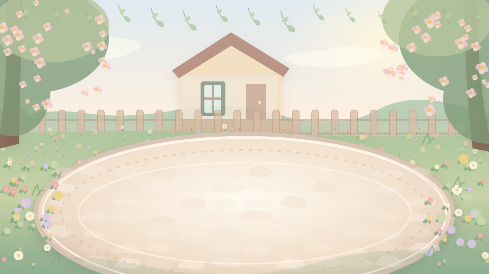](../../public/cat-bond/assets/battle-garden.svg) [battle-garden.svg](../../public/cat-bond/assets/battle-garden.svg) `battle-garden.svg` 70.4 KiB | [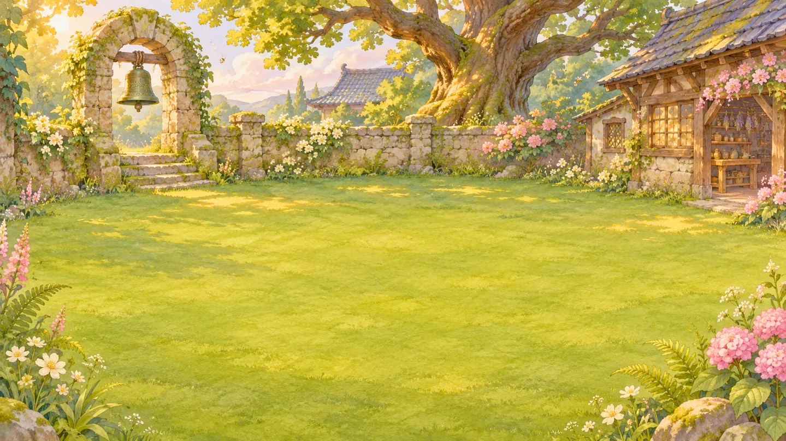](../../public/cat-bond/assets/garden/sunlit-garden-landscape.webp) [sunlit-garden-landscape.webp](../../public/cat-bond/assets/garden/sunlit-garden-landscape.webp) `garden/sunlit-garden-landscape.webp` 361.5 KiB | [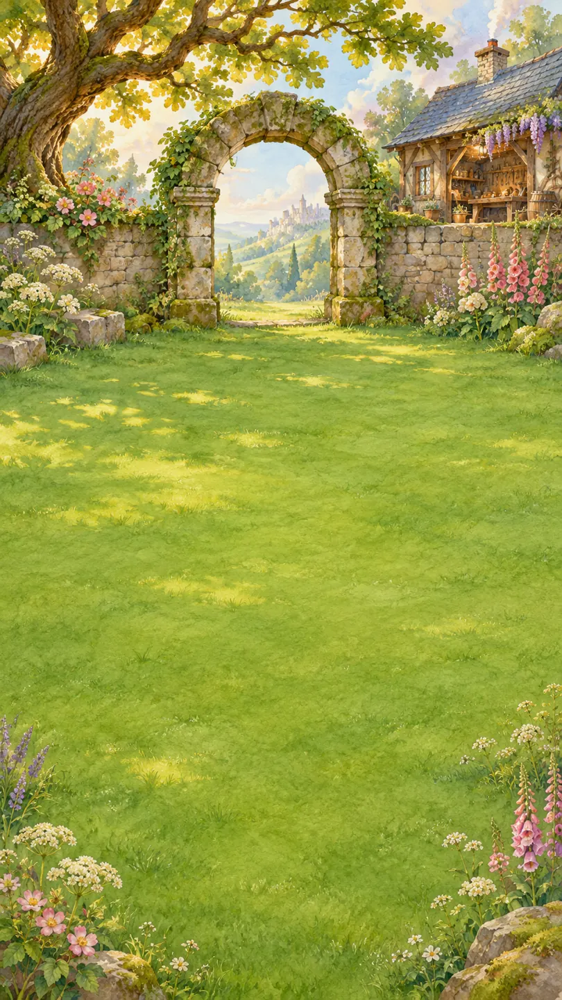](../../public/cat-bond/assets/garden/sunlit-garden-portrait.webp) [sunlit-garden-portrait.webp](../../public/cat-bond/assets/garden/sunlit-garden-portrait.webp) `garden/sunlit-garden-portrait.webp` 294.6 KiB |
| [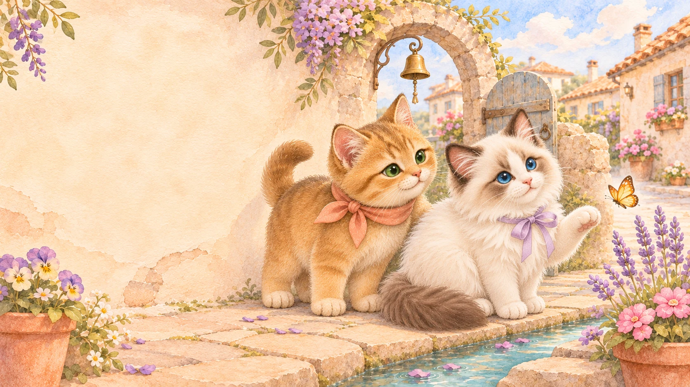](../../public/cat-bond/assets/garden/title-bell-sanctuary.webp) [title-bell-sanctuary.webp](../../public/cat-bond/assets/garden/title-bell-sanctuary.webp) `garden/title-bell-sanctuary.webp` 382.0 KiB | [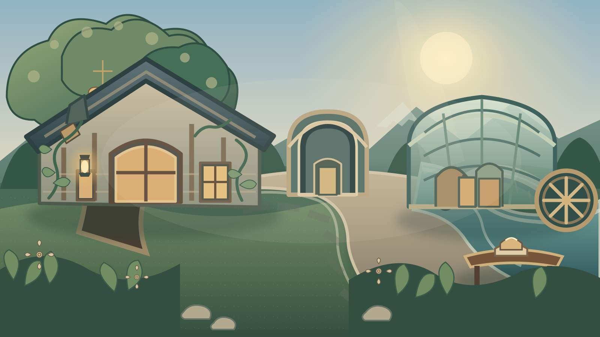](../../public/cat-bond/assets/sunlit-garden-cinematic.svg) [sunlit-garden-cinematic.svg](../../public/cat-bond/assets/sunlit-garden-cinematic.svg) `sunlit-garden-cinematic.svg` 260.9 KiB | [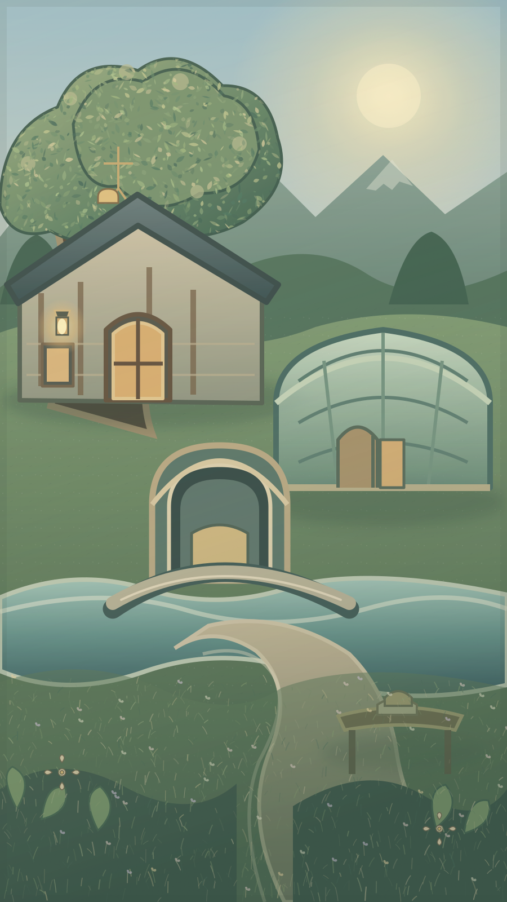](../../public/cat-bond/assets/sunlit-garden-portrait.svg) [sunlit-garden-portrait.svg](../../public/cat-bond/assets/sunlit-garden-portrait.svg) `sunlit-garden-portrait.svg` 257.6 KiB |
| [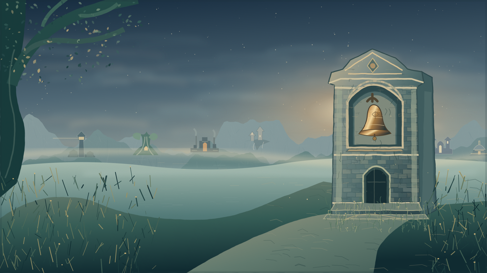](../../public/cat-bond/assets/title/star-bell-dawn.svg) [star-bell-dawn.svg](../../public/cat-bond/assets/title/star-bell-dawn.svg) `title/star-bell-dawn.svg` 312.8 KiB | [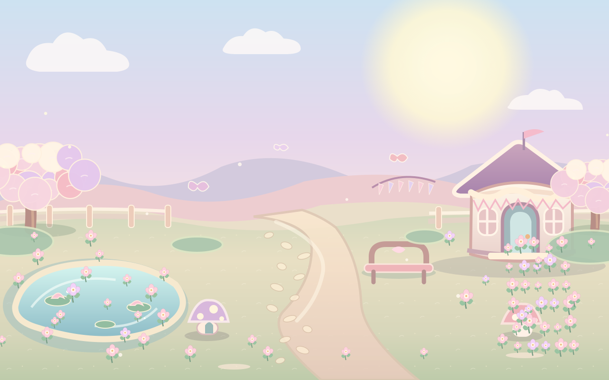](../../public/cat-bond/assets/yard-storybook.svg) [yard-storybook.svg](../../public/cat-bond/assets/yard-storybook.svg) `yard-storybook.svg` 54.5 KiB | [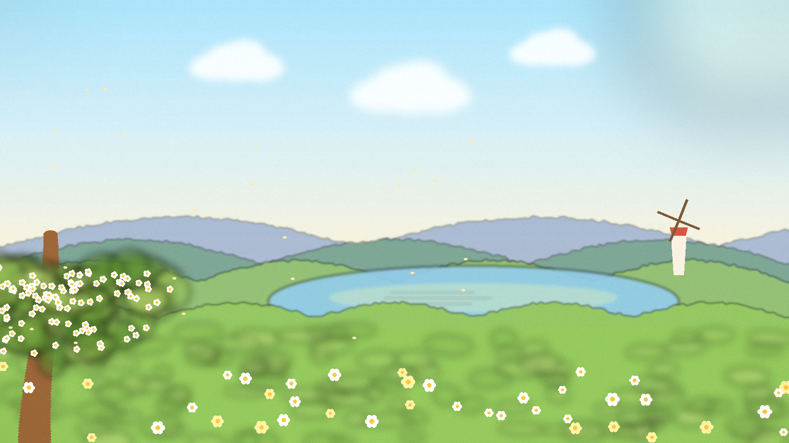](../../public/cat-bond/assets/yard_bg.png) [yard_bg.png](../../public/cat-bond/assets/yard_bg.png) `yard_bg.png` 1443.7 KiB |

### 02 · 可移动猫咪、首发猫与玩家剧情立绘（7）

| | | |
|---|---|---|
|  [jiafei-watercolor-v1.avif](../../public/cat-bond/assets/jiafei-watercolor-v1.avif) `jiafei-watercolor-v1.avif` 5.1 KiB 旧版 / 待核引用 |  [jiafei-watercolor-v2.webp](../../public/cat-bond/assets/jiafei-watercolor-v2.webp) `jiafei-watercolor-v2.webp` 7.5 KiB 移动猫渲染源 | [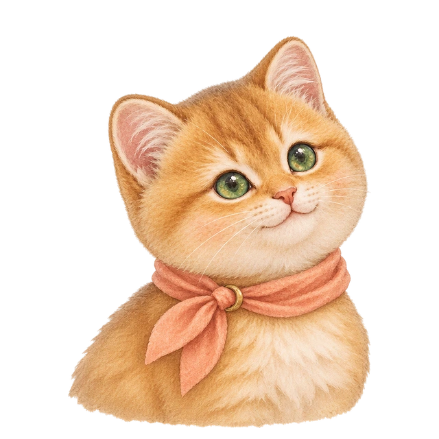](../../public/cat-bond/assets/player-portraits/jinjc.webp) [jinjc.webp](../../public/cat-bond/assets/player-portraits/jinjc.webp) `player-portraits/jinjc.webp` 103.8 KiB 剧情头像 |
| [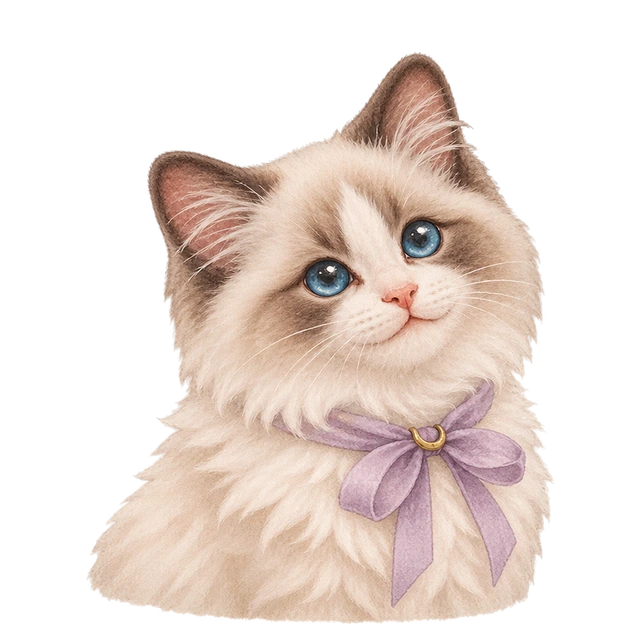](../../public/cat-bond/assets/player-portraits/yunduo.webp) [yunduo.webp](../../public/cat-bond/assets/player-portraits/yunduo.webp) `player-portraits/yunduo.webp` 100.1 KiB 剧情头像 | [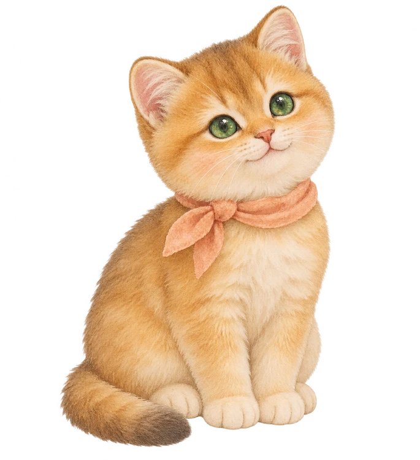](../../public/cat-bond/assets/starter-portraits/jinjc.webp) [jinjc.webp](../../public/cat-bond/assets/starter-portraits/jinjc.webp) `starter-portraits/jinjc.webp` 107.1 KiB 首发渲染 | [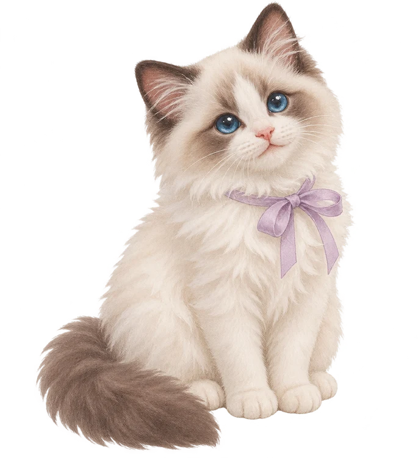](../../public/cat-bond/assets/starter-portraits/yunduo.webp) [yunduo.webp](../../public/cat-bond/assets/starter-portraits/yunduo.webp) `starter-portraits/yunduo.webp` 108.1 KiB 首发渲染 |
|  [watercolor-cats-v2.webp](../../public/cat-bond/assets/watercolor-cats-v2.webp) `watercolor-cats-v2.webp` 9.2 KiB 移动猫渲染源 |  |  |

### 03 · 暮铃：立绘与移动表现（17）

| | | |
|---|---|---|
| [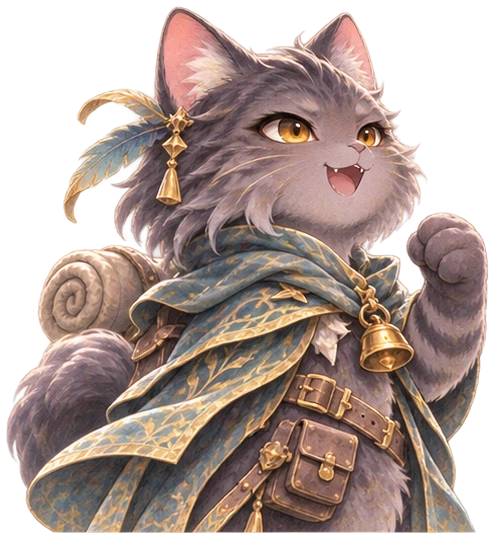](../../public/cat-bond/assets/cinematics/characters/muling/traveler-determined.webp) [traveler-determined.webp](../../public/cat-bond/assets/cinematics/characters/muling/traveler-determined.webp) `cinematics/characters/muling/traveler-determined.webp` 84.3 KiB 清单：candidate | [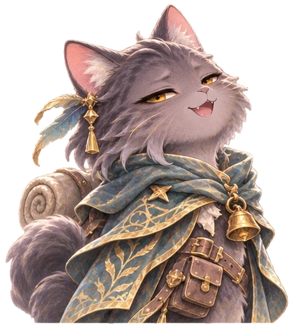](../../public/cat-bond/assets/cinematics/characters/muling/traveler-dry.webp) [traveler-dry.webp](../../public/cat-bond/assets/cinematics/characters/muling/traveler-dry.webp) `cinematics/characters/muling/traveler-dry.webp` 77.7 KiB 清单：candidate | [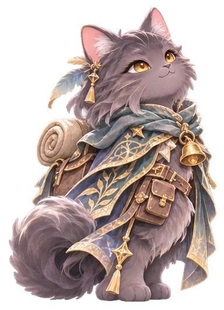](../../public/cat-bond/assets/cinematics/characters/muling/traveler-full.webp) [traveler-full.webp](../../public/cat-bond/assets/cinematics/characters/muling/traveler-full.webp) `cinematics/characters/muling/traveler-full.webp` 87.6 KiB 清单：candidate · 旧深色全身图（交接文档） |
| [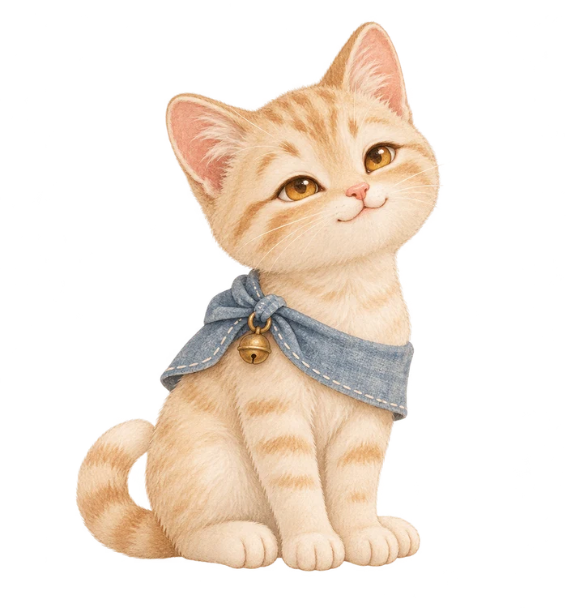](../../public/cat-bond/assets/cinematics/characters/muling/traveler-garden-sunlit.webp) [traveler-garden-sunlit.webp](../../public/cat-bond/assets/cinematics/characters/muling/traveler-garden-sunlit.webp) `cinematics/characters/muling/traveler-garden-sunlit.webp` 95.1 KiB | [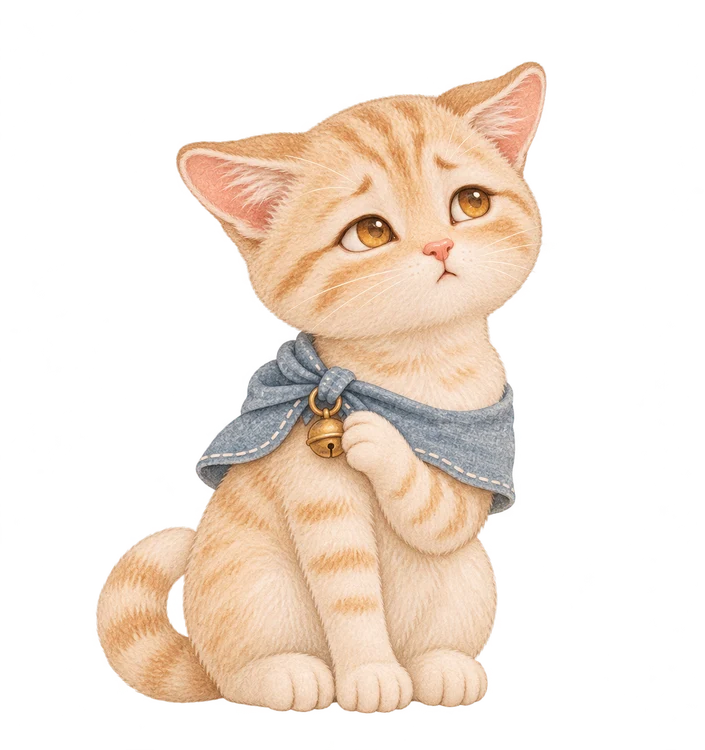](../../public/cat-bond/assets/cinematics/characters/muling/traveler-nervous.webp) [traveler-nervous.webp](../../public/cat-bond/assets/cinematics/characters/muling/traveler-nervous.webp) `cinematics/characters/muling/traveler-nervous.webp` 94.2 KiB 清单：candidate | [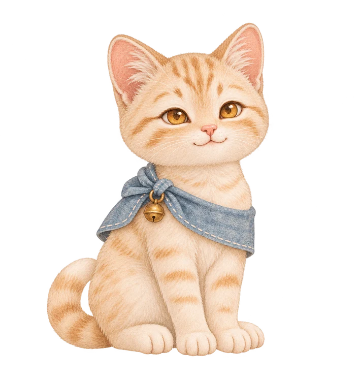](../../public/cat-bond/assets/cinematics/characters/muling/traveler-neutral.webp) [traveler-neutral.webp](../../public/cat-bond/assets/cinematics/characters/muling/traveler-neutral.webp) `cinematics/characters/muling/traveler-neutral.webp` 75.1 KiB 清单：candidate |
| [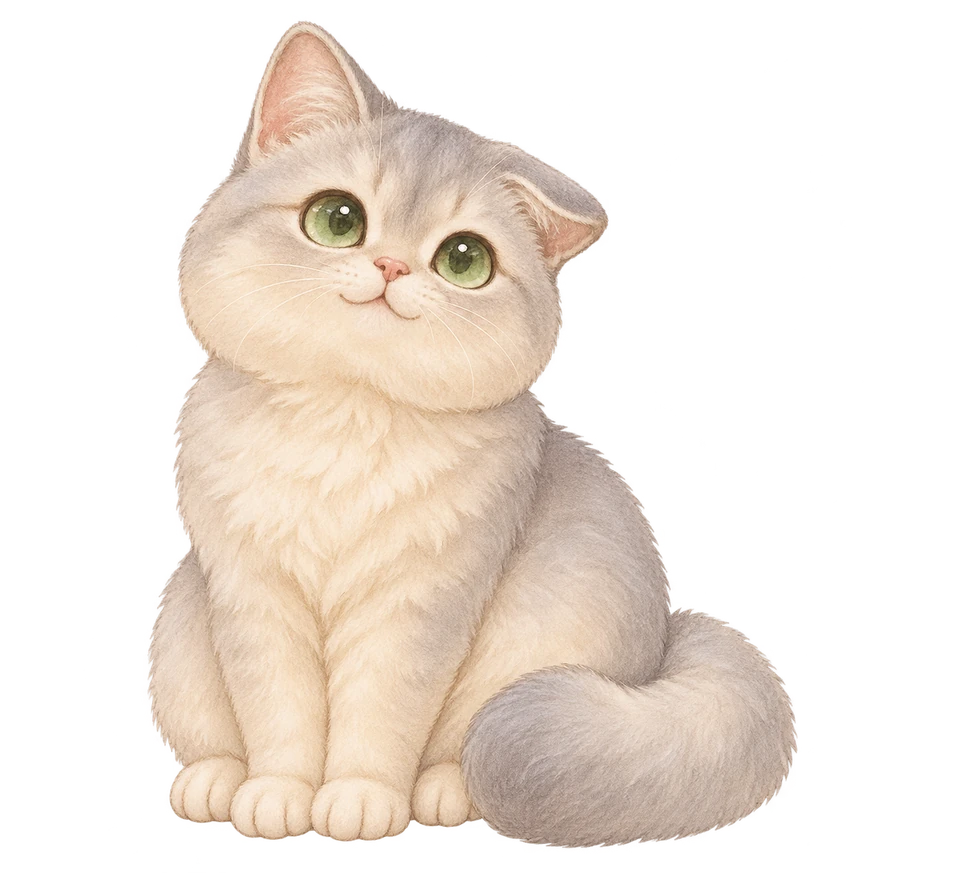](../../public/cat-bond/assets/cinematics/characters/muling/traveler-silver-cream.webp) [traveler-silver-cream.webp](../../public/cat-bond/assets/cinematics/characters/muling/traveler-silver-cream.webp) `cinematics/characters/muling/traveler-silver-cream.webp` 146.4 KiB 清单：candidate · 当前暮铃剧情头像 | [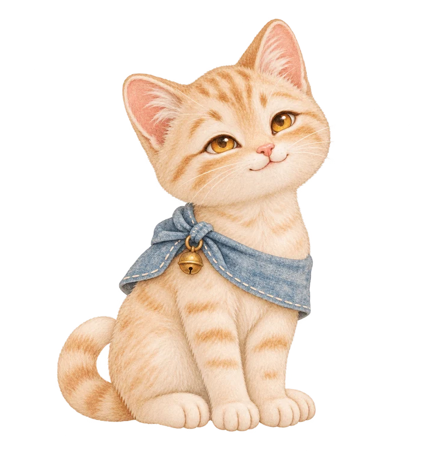](../../public/cat-bond/assets/cinematics/characters/muling/traveler-warm.webp) [traveler-warm.webp](../../public/cat-bond/assets/cinematics/characters/muling/traveler-warm.webp) `cinematics/characters/muling/traveler-warm.webp` 73.9 KiB 清单：candidate | [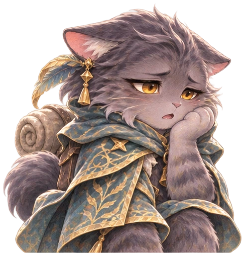](../../public/cat-bond/assets/cinematics/characters/muling/traveler-worried.webp) [traveler-worried.webp](../../public/cat-bond/assets/cinematics/characters/muling/traveler-worried.webp) `cinematics/characters/muling/traveler-worried.webp` 71.7 KiB 清单：candidate |
|  [muling-dry.svg](../../public/cat-bond/assets/npc/muling-dry.svg) `npc/muling-dry.svg` 6.4 KiB | [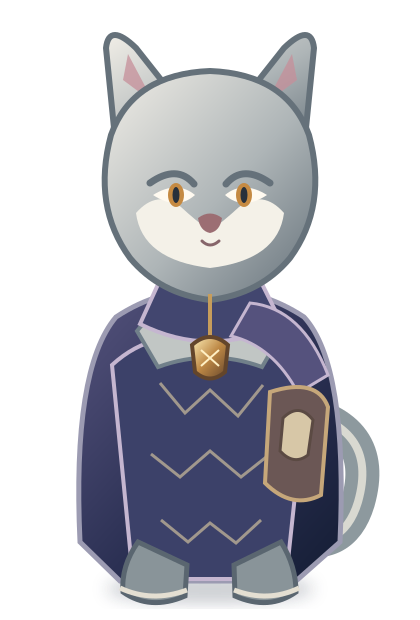](../../public/cat-bond/assets/npc/muling-follow-sprite.svg) [muling-follow-sprite.svg](../../public/cat-bond/assets/npc/muling-follow-sprite.svg) `npc/muling-follow-sprite.svg` 4.0 KiB | [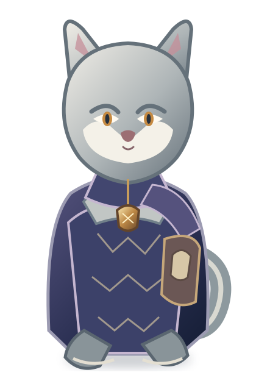](../../public/cat-bond/assets/npc/muling-follow-step-a.svg) [muling-follow-step-a.svg](../../public/cat-bond/assets/npc/muling-follow-step-a.svg) `npc/muling-follow-step-a.svg` 4.0 KiB |
| [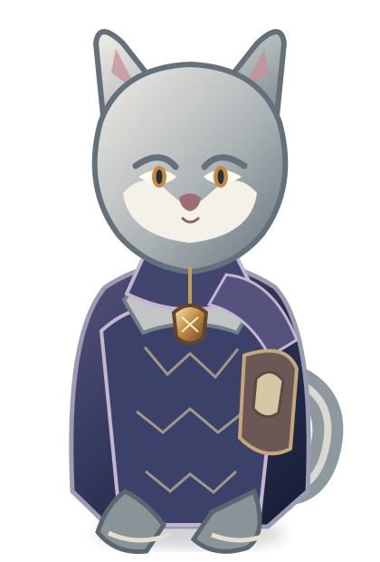](../../public/cat-bond/assets/npc/muling-follow-step-b.svg) [muling-follow-step-b.svg](../../public/cat-bond/assets/npc/muling-follow-step-b.svg) `npc/muling-follow-step-b.svg` 4.1 KiB | [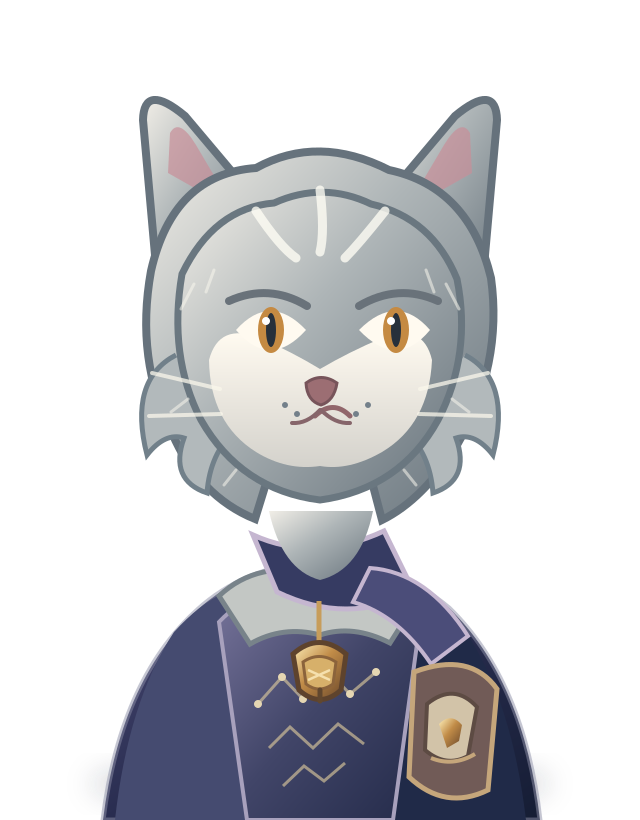](../../public/cat-bond/assets/npc/muling-nervous.svg) [muling-nervous.svg](../../public/cat-bond/assets/npc/muling-nervous.svg) `npc/muling-nervous.svg` 6.5 KiB | [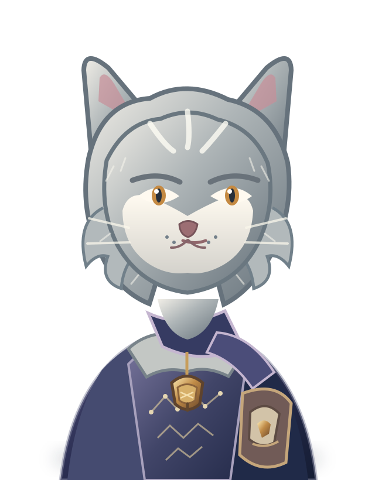](../../public/cat-bond/assets/npc/muling-neutral.svg) [muling-neutral.svg](../../public/cat-bond/assets/npc/muling-neutral.svg) `npc/muling-neutral.svg` 6.5 KiB |
|  [muling-sheepish.svg](../../public/cat-bond/assets/npc/muling-sheepish.svg) `npc/muling-sheepish.svg` 6.2 KiB |  [muling-warm.svg](../../public/cat-bond/assets/npc/muling-warm.svg) `npc/muling-warm.svg` 6.2 KiB |  |

### 04 · 十二位居民与旧表情图（21）

| | | |
|---|---|---|
| [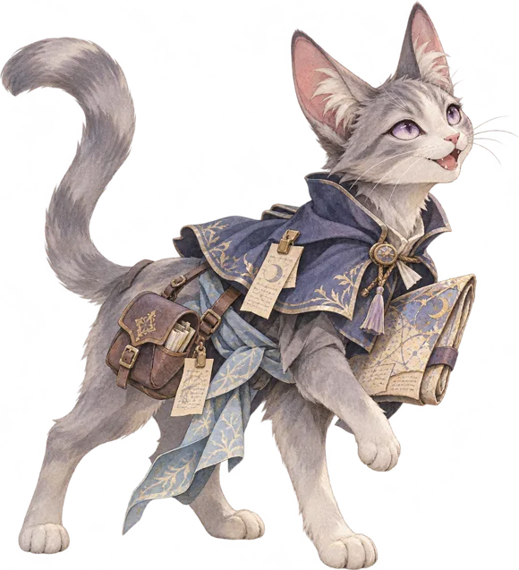](../../public/cat-bond/assets/npc/baikan-painted.webp) [baikan-painted.webp](../../public/cat-bond/assets/npc/baikan-painted.webp) `npc/baikan-painted.webp` 114.0 KiB 清单：candidate | [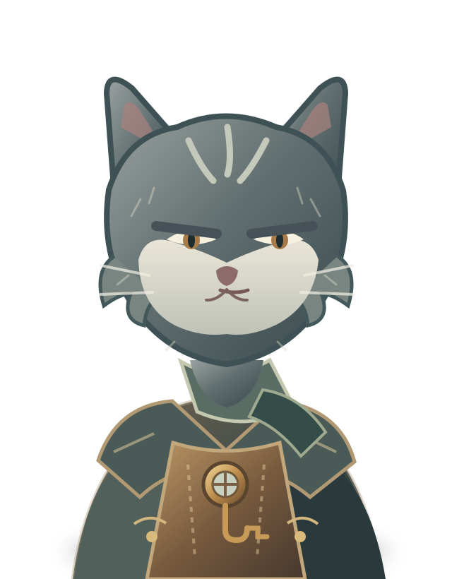](../../public/cat-bond/assets/npc/jiedeng-firm.svg) [jiedeng-firm.svg](../../public/cat-bond/assets/npc/jiedeng-firm.svg) `npc/jiedeng-firm.svg` 5.6 KiB |  [jiedeng-guarded.svg](../../public/cat-bond/assets/npc/jiedeng-guarded.svg) `npc/jiedeng-guarded.svg` 5.6 KiB |
| [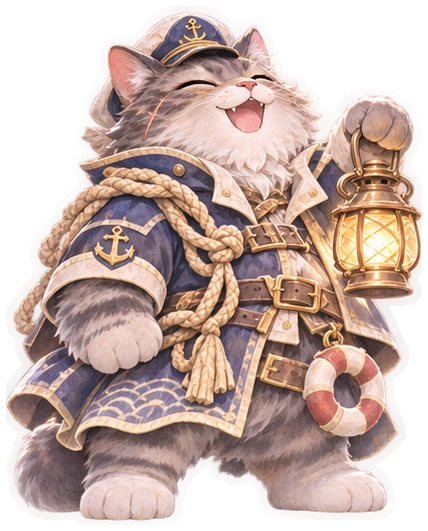](../../public/cat-bond/assets/npc/jiedeng-painted.webp) [jiedeng-painted.webp](../../public/cat-bond/assets/npc/jiedeng-painted.webp) `npc/jiedeng-painted.webp` 100.4 KiB 清单：candidate | [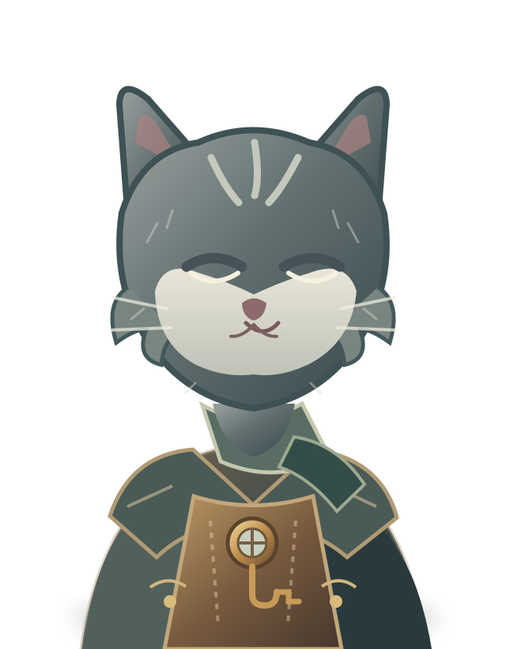](../../public/cat-bond/assets/npc/jiedeng-soft.svg) [jiedeng-soft.svg](../../public/cat-bond/assets/npc/jiedeng-soft.svg) `npc/jiedeng-soft.svg` 5.4 KiB |  [jiedeng-worried.svg](../../public/cat-bond/assets/npc/jiedeng-worried.svg) `npc/jiedeng-worried.svg` 5.6 KiB |
| [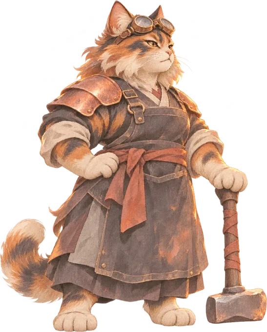](../../public/cat-bond/assets/npc/jinpo-painted.webp) [jinpo-painted.webp](../../public/cat-bond/assets/npc/jinpo-painted.webp) `npc/jinpo-painted.webp` 122.7 KiB 清单：candidate |  [lichuan-painted.webp](../../public/cat-bond/assets/npc/lichuan-painted.webp) `npc/lichuan-painted.webp` 167.0 KiB 清单：candidate | [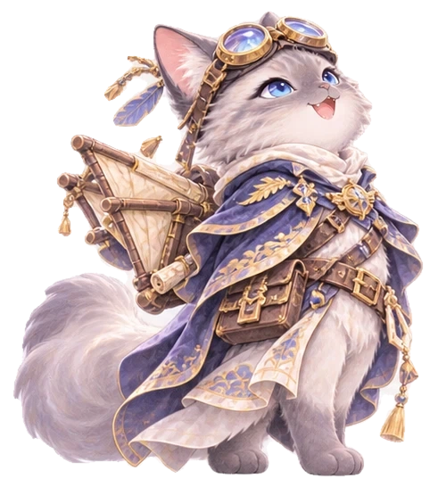](../../public/cat-bond/assets/npc/lingyu-painted.webp) [lingyu-painted.webp](../../public/cat-bond/assets/npc/lingyu-painted.webp) `npc/lingyu-painted.webp` 117.7 KiB 清单：candidate |
| [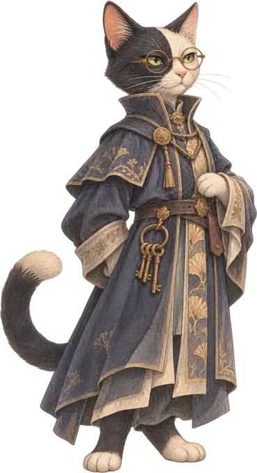](../../public/cat-bond/assets/npc/moye-painted.webp) [moye-painted.webp](../../public/cat-bond/assets/npc/moye-painted.webp) `npc/moye-painted.webp` 117.6 KiB 清单：candidate |  [qilan-annoyed.svg](../../public/cat-bond/assets/npc/qilan-annoyed.svg) `npc/qilan-annoyed.svg` 7.6 KiB | [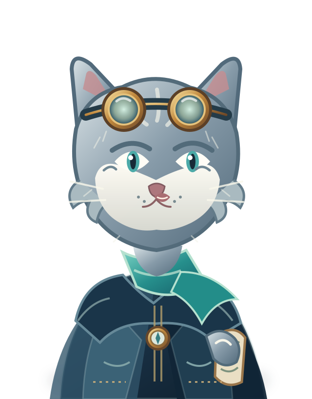](../../public/cat-bond/assets/npc/qilan-curious.svg) [qilan-curious.svg](../../public/cat-bond/assets/npc/qilan-curious.svg) `npc/qilan-curious.svg` 7.7 KiB |
|  [qilan-determined.svg](../../public/cat-bond/assets/npc/qilan-determined.svg) `npc/qilan-determined.svg` 7.6 KiB | [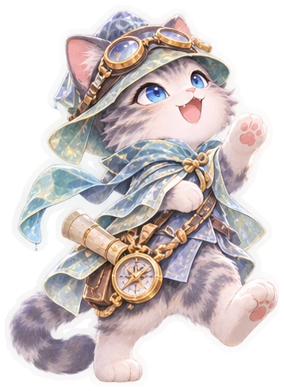](../../public/cat-bond/assets/npc/qilan-painted.webp) [qilan-painted.webp](../../public/cat-bond/assets/npc/qilan-painted.webp) `npc/qilan-painted.webp` 78.6 KiB 清单：candidate | [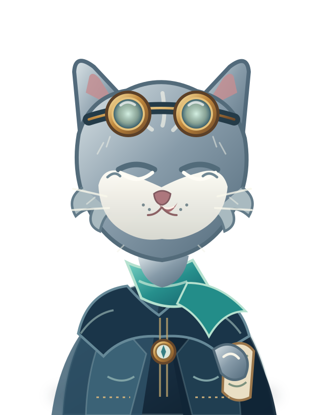](../../public/cat-bond/assets/npc/qilan-warm.svg) [qilan-warm.svg](../../public/cat-bond/assets/npc/qilan-warm.svg) `npc/qilan-warm.svg` 7.5 KiB |
|  [qilan-worried.svg](../../public/cat-bond/assets/npc/qilan-worried.svg) `npc/qilan-worried.svg` 7.7 KiB | [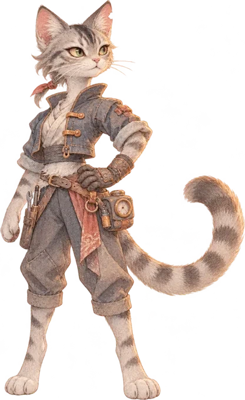](../../public/cat-bond/assets/npc/xiaomao-painted.webp) [xiaomao-painted.webp](../../public/cat-bond/assets/npc/xiaomao-painted.webp) `npc/xiaomao-painted.webp` 96.8 KiB 清单：candidate | [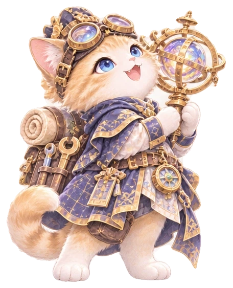](../../public/cat-bond/assets/npc/xingya-painted.webp) [xingya-painted.webp](../../public/cat-bond/assets/npc/xingya-painted.webp) `npc/xingya-painted.webp` 124.4 KiB 清单：candidate |
| [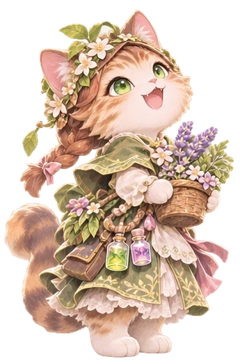](../../public/cat-bond/assets/npc/yahe-painted.webp) [yahe-painted.webp](../../public/cat-bond/assets/npc/yahe-painted.webp) `npc/yahe-painted.webp` 87.2 KiB 清单：candidate | [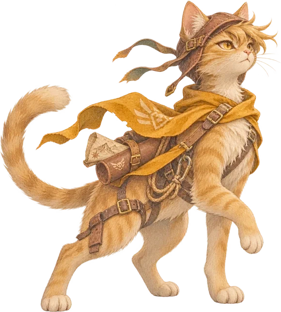](../../public/cat-bond/assets/npc/yuanfan-painted.webp) [yuanfan-painted.webp](../../public/cat-bond/assets/npc/yuanfan-painted.webp) `npc/yuanfan-painted.webp` 107.8 KiB 清单：candidate | [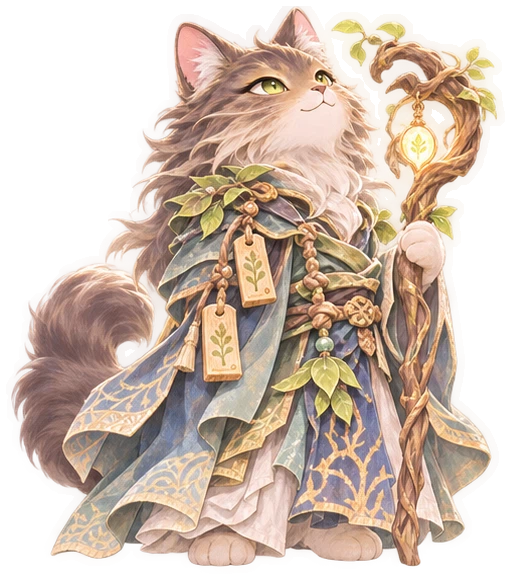](../../public/cat-bond/assets/npc/yuchuan-painted.webp) [yuchuan-painted.webp](../../public/cat-bond/assets/npc/yuchuan-painted.webp) `npc/yuchuan-painted.webp` 135.0 KiB 清单：candidate |

### 05 · 序章原画（6）

| | | |
|---|---|---|
| [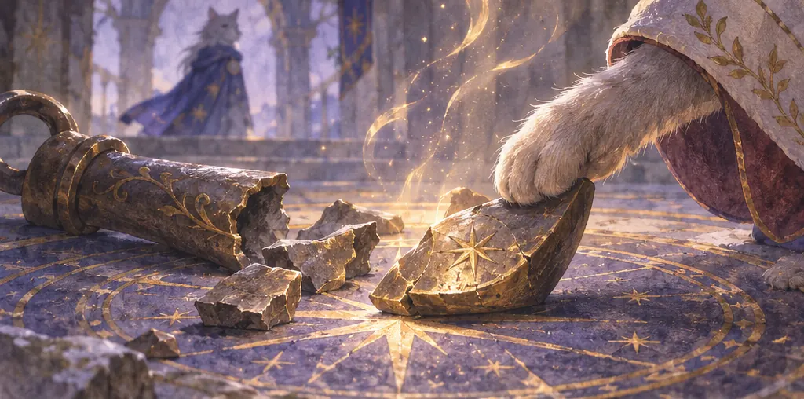](../../public/cat-bond/assets/cinematics/prologue/broken-bell-tongue.webp) [broken-bell-tongue.webp](../../public/cat-bond/assets/cinematics/prologue/broken-bell-tongue.webp) `cinematics/prologue/broken-bell-tongue.webp` 394.2 KiB 清单：candidate | [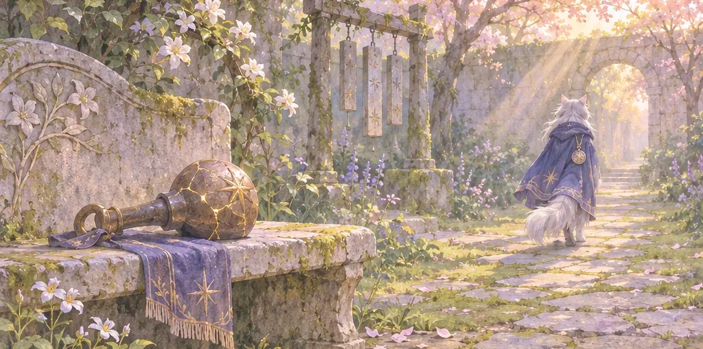](../../public/cat-bond/assets/cinematics/prologue/garden-at-dawn.webp) [garden-at-dawn.webp](../../public/cat-bond/assets/cinematics/prologue/garden-at-dawn.webp) `cinematics/prologue/garden-at-dawn.webp` 390.2 KiB 清单：candidate | [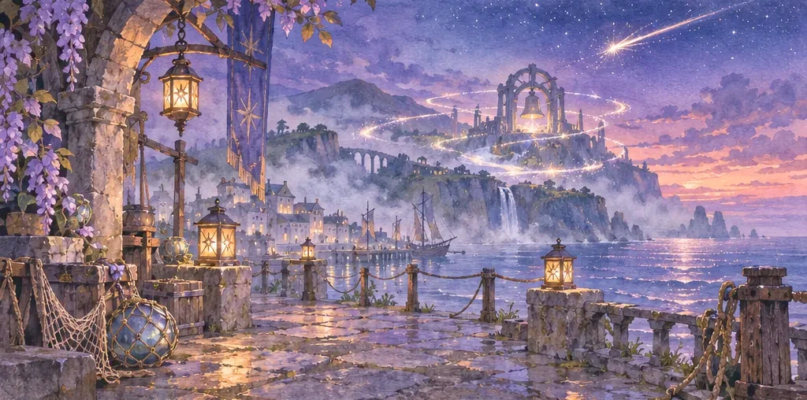](../../public/cat-bond/assets/cinematics/prologue/harbor-at-twilight.webp) [harbor-at-twilight.webp](../../public/cat-bond/assets/cinematics/prologue/harbor-at-twilight.webp) `cinematics/prologue/harbor-at-twilight.webp` 441.2 KiB 清单：candidate |
| [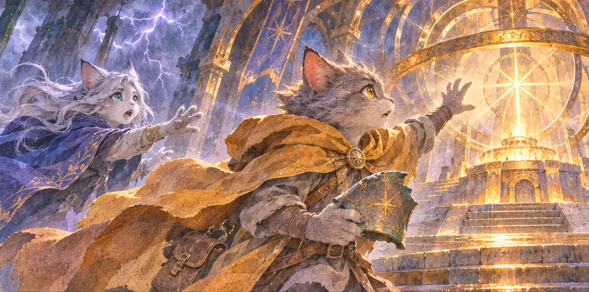](../../public/cat-bond/assets/cinematics/prologue/keepers-choice.webp) [keepers-choice.webp](../../public/cat-bond/assets/cinematics/prologue/keepers-choice.webp) `cinematics/prologue/keepers-choice.webp` 423.1 KiB 清单：candidate | [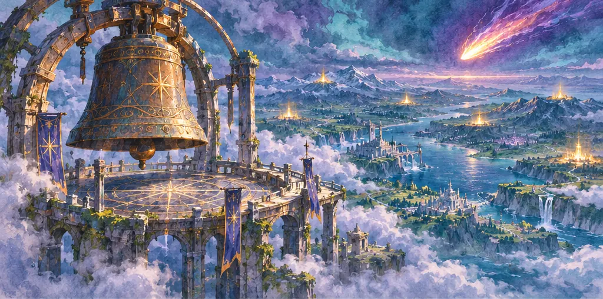](../../public/cat-bond/assets/cinematics/prologue/star-bell.webp) [star-bell.webp](../../public/cat-bond/assets/cinematics/prologue/star-bell.webp) `cinematics/prologue/star-bell.webp` 342.8 KiB 清单：candidate | [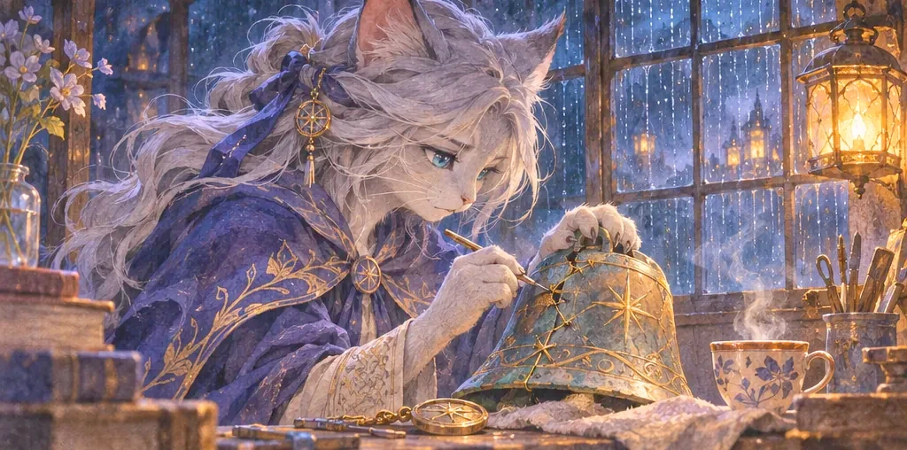](../../public/cat-bond/assets/cinematics/prologue/waiting-at-workbench.webp) [waiting-at-workbench.webp](../../public/cat-bond/assets/cinematics/prologue/waiting-at-workbench.webp) `cinematics/prologue/waiting-at-workbench.webp` 408.8 KiB 清单：candidate |

### 06 · 结局原画（6）

| | | |
|---|---|---|
| [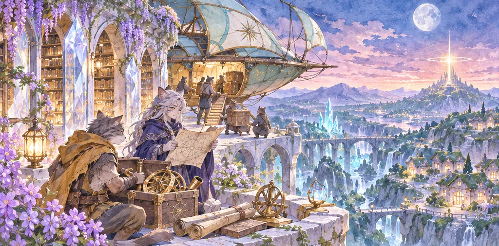](../../public/cat-bond/assets/cinematics/closing/couriers-at-library.webp) [couriers-at-library.webp](../../public/cat-bond/assets/cinematics/closing/couriers-at-library.webp) `cinematics/closing/couriers-at-library.webp` 394.8 KiB 清单：candidate | [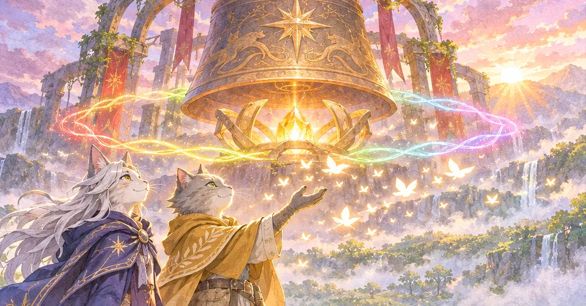](../../public/cat-bond/assets/cinematics/closing/final-note.webp) [final-note.webp](../../public/cat-bond/assets/cinematics/closing/final-note.webp) `cinematics/closing/final-note.webp` 352.7 KiB 清单：candidate |  [harbor-forest-delivery.webp](../../public/cat-bond/assets/cinematics/closing/harbor-forest-delivery.webp) `cinematics/closing/harbor-forest-delivery.webp` 490.3 KiB 清单：candidate |
|  [inward-call.webp](../../public/cat-bond/assets/cinematics/closing/inward-call.webp) `cinematics/closing/inward-call.webp` 361.2 KiB 清单：candidate |  [memories-return.webp](../../public/cat-bond/assets/cinematics/closing/memories-return.webp) `cinematics/closing/memories-return.webp` 323.4 KiB 清单：candidate |  [pendant-signal.webp](../../public/cat-bond/assets/cinematics/closing/pendant-signal.webp) `cinematics/closing/pendant-signal.webp` 322.4 KiB 清单：candidate |

### 07 · 世界地图、六地区场景与水闸背景（16）

| | | |
|---|---|---|
|  [atlas.svg](../../public/cat-bond/assets/resonance-world-v2/atlas.svg) `resonance-world-v2/atlas.svg` 197.5 KiB SVG / 部分是回退 |  [atlas.webp](../../public/cat-bond/assets/resonance-world-v2/atlas.webp) `resonance-world-v2/atlas.webp` 499.2 KiB |  [forest-waterworks.webp](../../public/cat-bond/assets/resonance-world-v2/forest-waterworks.webp) `resonance-world-v2/forest-waterworks.webp` 549.6 KiB |
|  [forest.svg](../../public/cat-bond/assets/resonance-world-v2/forest.svg) `resonance-world-v2/forest.svg` 359.3 KiB SVG / 部分是回退 |  [forest.webp](../../public/cat-bond/assets/resonance-world-v2/forest.webp) `resonance-world-v2/forest.webp` 521.6 KiB |  [forge.svg](../../public/cat-bond/assets/resonance-world-v2/forge.svg) `resonance-world-v2/forge.svg` 120.8 KiB SVG / 部分是回退 |
|  [forge.webp](../../public/cat-bond/assets/resonance-world-v2/forge.webp) `resonance-world-v2/forge.webp` 403.3 KiB |  [harbor-mist.webp](../../public/cat-bond/assets/resonance-world-v2/harbor-mist.webp) `resonance-world-v2/harbor-mist.webp` 447.3 KiB 同 SHA 重复 |  [harbor.svg](../../public/cat-bond/assets/resonance-world-v2/harbor.svg) `resonance-world-v2/harbor.svg` 141.2 KiB SVG / 部分是回退 |
|  [harbor.webp](../../public/cat-bond/assets/resonance-world-v2/harbor.webp) `resonance-world-v2/harbor.webp` 447.3 KiB 同 SHA 重复 |  [library.svg](../../public/cat-bond/assets/resonance-world-v2/library.svg) `resonance-world-v2/library.svg` 123.0 KiB SVG / 部分是回退 |  [library.webp](../../public/cat-bond/assets/resonance-world-v2/library.webp) `resonance-world-v2/library.webp` 432.5 KiB |
|  [sky.svg](../../public/cat-bond/assets/resonance-world-v2/sky.svg) `resonance-world-v2/sky.svg` 84.5 KiB SVG / 部分是回退 |  [sky.webp](../../public/cat-bond/assets/resonance-world-v2/sky.webp) `resonance-world-v2/sky.webp` 404.6 KiB |  [starfall.svg](../../public/cat-bond/assets/resonance-world-v2/starfall.svg) `resonance-world-v2/starfall.svg` 112.0 KiB SVG / 部分是回退 |
|  [starfall.webp](../../public/cat-bond/assets/resonance-world-v2/starfall.webp) `resonance-world-v2/starfall.webp` 445.3 KiB |  |  |

### 08 · 战斗背景、区域敌人、终战场景（28）

| | | |
|---|---|---|
|  [emberforge-arena.svg](../../public/cat-bond/assets/combat/emberforge-arena.svg) `combat/emberforge-arena.svg` 7.6 KiB SVG / 部分是回退 |  [emberforge-painted.webp](../../public/cat-bond/assets/combat/emberforge-painted.webp) `combat/emberforge-painted.webp` 204.8 KiB |  [forest-arena.svg](../../public/cat-bond/assets/combat/forest-arena.svg) `combat/forest-arena.svg` 95.9 KiB SVG / 部分是回退 |
|  [forest-arena.webp](../../public/cat-bond/assets/combat/forest-arena.webp) `combat/forest-arena.webp` 182.9 KiB |  [forge-guardian-painted.webp](../../public/cat-bond/assets/combat/forge-guardian-painted.webp) `combat/forge-guardian-painted.webp` 182.7 KiB |  [forge-guardian.svg](../../public/cat-bond/assets/combat/forge-guardian.svg) `combat/forge-guardian.svg` 5.7 KiB SVG / 部分是回退 |
|  [gale-wing-watercolor.webp](../../public/cat-bond/assets/combat/gale-wing-watercolor.webp) `combat/gale-wing-watercolor.webp` 66.5 KiB |  [gale-wing.svg](../../public/cat-bond/assets/combat/gale-wing.svg) `combat/gale-wing.svg` 3.2 KiB SVG / 部分是回退 |  [harbor-arena.svg](../../public/cat-bond/assets/combat/harbor-arena.svg) `combat/harbor-arena.svg` 33.8 KiB SVG / 部分是回退 |
|  [harbor-arena.webp](../../public/cat-bond/assets/combat/harbor-arena.webp) `combat/harbor-arena.webp` 202.2 KiB |  [jinpo-portrait.svg](../../public/cat-bond/assets/combat/jinpo-portrait.svg) `combat/jinpo-portrait.svg` 2.4 KiB SVG / 部分是回退 |  [library-arena.svg](../../public/cat-bond/assets/combat/library-arena.svg) `combat/library-arena.svg` 75.9 KiB SVG / 部分是回退 |
|  [library-arena.webp](../../public/cat-bond/assets/combat/library-arena.webp) `combat/library-arena.webp` 170.2 KiB |  [mirror-sentinel-watercolor.webp](../../public/cat-bond/assets/combat/mirror-sentinel-watercolor.webp) `combat/mirror-sentinel-watercolor.webp` 68.5 KiB |  [mirror-sentinel.svg](../../public/cat-bond/assets/combat/mirror-sentinel.svg) `combat/mirror-sentinel.svg` 2.8 KiB SVG / 部分是回退 |
|  [orbit-sentinel-watercolor.webp](../../public/cat-bond/assets/combat/orbit-sentinel-watercolor.webp) `combat/orbit-sentinel-watercolor.webp` 64.1 KiB |  [orbit-sentinel.svg](../../public/cat-bond/assets/combat/orbit-sentinel.svg) `combat/orbit-sentinel.svg` 2.9 KiB SVG / 部分是回退 |  [rootbound-watercolor.webp](../../public/cat-bond/assets/combat/rootbound-watercolor.webp) `combat/rootbound-watercolor.webp` 79.5 KiB |
|  [rootbound.svg](../../public/cat-bond/assets/combat/rootbound.svg) `combat/rootbound.svg` 5.7 KiB SVG / 部分是回退 |  [sky-arena.svg](../../public/cat-bond/assets/combat/sky-arena.svg) `combat/sky-arena.svg` 46.0 KiB SVG / 部分是回退 |  [sky-arena.webp](../../public/cat-bond/assets/combat/sky-arena.webp) `combat/sky-arena.webp` 162.4 KiB |
|  [star-bell-arena-portrait.webp](../../public/cat-bond/assets/combat/star-bell-arena-portrait.webp) `combat/star-bell-arena-portrait.webp` 174.0 KiB |  [star-bell-arena-wide.webp](../../public/cat-bond/assets/combat/star-bell-arena-wide.webp) `combat/star-bell-arena-wide.webp` 192.7 KiB |  [starfall-arena.svg](../../public/cat-bond/assets/combat/starfall-arena.svg) `combat/starfall-arena.svg` 57.3 KiB SVG / 部分是回退 |
|  [starfall-arena.webp](../../public/cat-bond/assets/combat/starfall-arena.webp) `combat/starfall-arena.webp` 142.0 KiB |  [tide-shell-watercolor.webp](../../public/cat-bond/assets/combat/tide-shell-watercolor.webp) `combat/tide-shell-watercolor.webp` 70.4 KiB |  [tide-shell.svg](../../public/cat-bond/assets/combat/tide-shell.svg) `combat/tide-shell.svg` 3.0 KiB SVG / 部分是回退 |
|  [xiaomao-portrait.svg](../../public/cat-bond/assets/combat/xiaomao-portrait.svg) `combat/xiaomao-portrait.svg` 2.3 KiB SVG / 部分是回退 |  |  |

### 09 · 双猫合击：原画图集与旧图集（4）

| | | |
|---|---|---|
|  [duo-premium-sheet.webp](../../public/cat-bond/assets/duo-premium-sheet.webp) `duo-premium-sheet.webp` 328.5 KiB 旧图集 / 待核引用 |  [duo-scene-backgrounds.webp](../../public/cat-bond/assets/duo-scene-backgrounds.webp) `duo-scene-backgrounds.webp` 2.3 KiB 旧图集 / 待核引用 |  [duo-stage-clean-21x3-v1.webp](../../public/cat-bond/assets/duo-stage-clean-21x3-v1.webp) `duo-stage-clean-21x3-v1.webp` 198.8 KiB 旧图集 / 待核引用 |
|  [duo-storyboard-21x3-v3.webp](../../public/cat-bond/assets/duo-storyboard-21x3-v3.webp) `duo-storyboard-21x3-v3.webp` 2107.9 KiB 当前合击图集 / 63 帧 |  |  |

### 10 · 家园设施、地区项目、道具（30）

| | | |
|---|---|---|
|  [catnip.svg](../../public/cat-bond/assets/garden/catnip.svg) `garden/catnip.svg` 5.1 KiB |  [cattree.svg](../../public/cat-bond/assets/garden/cattree.svg) `garden/cattree.svg` 2.1 KiB |  [cave.svg](../../public/cat-bond/assets/garden/cave.svg) `garden/cave.svg` 1.8 KiB |
|  [foliage.svg](../../public/cat-bond/assets/garden/foliage.svg) `garden/foliage.svg` 28.0 KiB |  [garden-lantern.svg](../../public/cat-bond/assets/garden/garden-lantern.svg) `garden/garden-lantern.svg` 3.0 KiB |  [hammock.svg](../../public/cat-bond/assets/garden/hammock.svg) `garden/hammock.svg` 1.8 KiB |
|  [moonflower-planter.svg](../../public/cat-bond/assets/garden/moonflower-planter.svg) `garden/moonflower-planter.svg` 3.8 KiB |  [forest.svg](../../public/cat-bond/assets/garden/projects/forest.svg) `garden/projects/forest.svg` 3.8 KiB |  [forge.svg](../../public/cat-bond/assets/garden/projects/forge.svg) `garden/projects/forge.svg` 3.4 KiB |
|  [harbor.svg](../../public/cat-bond/assets/garden/projects/harbor.svg) `garden/projects/harbor.svg` 3.6 KiB |  [library.svg](../../public/cat-bond/assets/garden/projects/library.svg) `garden/projects/library.svg` 3.7 KiB |  [sky.svg](../../public/cat-bond/assets/garden/projects/sky.svg) `garden/projects/sky.svg` 3.4 KiB |
|  [starfall.svg](../../public/cat-bond/assets/garden/projects/starfall.svg) `garden/projects/starfall.svg` 3.6 KiB |  [scratcher.svg](../../public/cat-bond/assets/garden/scratcher.svg) `garden/scratcher.svg` 2.8 KiB |  [bell-pin.svg](../../public/cat-bond/assets/npc/props/bell-pin.svg) `npc/props/bell-pin.svg` 1.1 KiB |
|  [bell-shell.svg](../../public/cat-bond/assets/npc/props/bell-shell.svg) `npc/props/bell-shell.svg` 1.7 KiB |  [bell-sunlit.webp](../../public/cat-bond/assets/npc/props/bell-sunlit.webp) `npc/props/bell-sunlit.webp` 69.3 KiB |  [bell-tongue.svg](../../public/cat-bond/assets/npc/props/bell-tongue.svg) `npc/props/bell-tongue.svg` 1.1 KiB |
|  [garden-key.svg](../../public/cat-bond/assets/npc/props/garden-key.svg) `npc/props/garden-key.svg` 1.5 KiB |  [tea-cup.svg](../../public/cat-bond/assets/npc/props/tea-cup.svg) `npc/props/tea-cup.svg` 1.2 KiB |  [tea-leaves.svg](../../public/cat-bond/assets/npc/props/tea-leaves.svg) `npc/props/tea-leaves.svg` 0.9 KiB |
|  [tea-pot.svg](../../public/cat-bond/assets/npc/props/tea-pot.svg) `npc/props/tea-pot.svg` 2.2 KiB |  [water-kettle.svg](../../public/cat-bond/assets/npc/props/water-kettle.svg) `npc/props/water-kettle.svg` 1.7 KiB |  [workbench.svg](../../public/cat-bond/assets/npc/props/workbench.svg) `npc/props/workbench.svg` 1.3 KiB |
|  [gate-handle.webp](../../public/cat-bond/assets/waterworks/gate-handle.webp) `waterworks/gate-handle.webp` 23.3 KiB |  [pressure-gauge.webp](../../public/cat-bond/assets/waterworks/pressure-gauge.webp) `waterworks/pressure-gauge.webp` 31.8 KiB |  [sluice-panel.webp](../../public/cat-bond/assets/waterworks/sluice-panel.webp) `waterworks/sluice-panel.webp` 42.3 KiB |
|  [tangled-roots.webp](../../public/cat-bond/assets/waterworks/tangled-roots.webp) `waterworks/tangled-roots.webp` 42.8 KiB |  [valve-wheel.webp](../../public/cat-bond/assets/waterworks/valve-wheel.webp) `waterworks/valve-wheel.webp` 42.8 KiB |  [water-release.webp](../../public/cat-bond/assets/waterworks/water-release.webp) `waterworks/water-release.webp` 42.8 KiB |

### 11 · UI 图标、金币及其他（5）

| | | |
|---|---|---|
|  [gold-coin.svg](../../public/cat-bond/assets/gold-coin.svg) `gold-coin.svg` 1.8 KiB |  [close.svg](../../public/cat-bond/assets/ui/close.svg) `ui/close.svg` 0.2 KiB |  [dodge.svg](../../public/cat-bond/assets/ui/dodge.svg) `ui/dodge.svg` 0.2 KiB |
|  [duo.svg](../../public/cat-bond/assets/ui/duo.svg) `ui/duo.svg` 0.3 KiB |  [lock.svg](../../public/cat-bond/assets/ui/lock.svg) `ui/lock.svg` 0.3 KiB |  |

## 旧稿、重复与缺口

- 剧情清单里当前树不存在的条目：14（保留清单的归档 SHA，不显示为当前资产）。
  - `assets/cinematics/regions/region-misttide-harbor.svg` · rejected · [归档提交](https://github.com/claudialeee/morrowwish/commit/4e42ac8ec8ac23215154462c5e9f62bde589b46a)
  - `assets/cinematics/regions/region-rootsleep-forest.svg` · rejected · [归档提交](https://github.com/claudialeee/morrowwish/commit/4e42ac8ec8ac23215154462c5e9f62bde589b46a)
  - `assets/cinematics/regions/region-emberforge-city.svg` · rejected · [归档提交](https://github.com/claudialeee/morrowwish/commit/4e42ac8ec8ac23215154462c5e9f62bde589b46a)
  - `assets/cinematics/regions/region-skyspine-isles.svg` · rejected · [归档提交](https://github.com/claudialeee/morrowwish/commit/4e42ac8ec8ac23215154462c5e9f62bde589b46a)
  - `assets/cinematics/regions/region-moonmirror-library.svg` · rejected · [归档提交](https://github.com/claudialeee/morrowwish/commit/4e42ac8ec8ac23215154462c5e9f62bde589b46a)
  - `assets/cinematics/regions/region-starfall-expanse.svg` · rejected · [归档提交](https://github.com/claudialeee/morrowwish/commit/4e42ac8ec8ac23215154462c5e9f62bde589b46a)
  - `assets/cinematics/prologue/p01-six-sanctuaries.svg` · rejected · [归档提交](https://github.com/claudialeee/morrowwish/commit/4e42ac8ec8ac23215154462c5e9f62bde589b46a)
  - `assets/cinematics/prologue/p02-first-bellkeepers-choice.svg` · rejected · [归档提交](https://github.com/claudialeee/morrowwish/commit/4e42ac8ec8ac23215154462c5e9f62bde589b46a)
  - `assets/cinematics/prologue/p03-years-of-waiting.svg` · rejected · [归档提交](https://github.com/claudialeee/morrowwish/commit/4e42ac8ec8ac23215154462c5e9f62bde589b46a)
  - `assets/cinematics/prologue/p04-awakening.svg` · rejected · [归档提交](https://github.com/claudialeee/morrowwish/commit/4e42ac8ec8ac23215154462c5e9f62bde589b46a)
  - `assets/cinematics/prologue/p05-the-journey.svg` · rejected · [归档提交](https://github.com/claudialeee/morrowwish/commit/4e42ac8ec8ac23215154462c5e9f62bde589b46a)
  - `assets/cinematics/finale/b03-six-notes-return.svg` · rejected · [归档提交](https://github.com/claudialeee/morrowwish/commit/4e42ac8ec8ac23215154462c5e9f62bde589b46a)
  - `assets/cinematics/epilogue/e01-six-regions-answer.svg` · rejected · [归档提交](https://github.com/claudialeee/morrowwish/commit/4e42ac8ec8ac23215154462c5e9f62bde589b46a)
  - `assets/cinematics/epilogue/e03-sunlit-garden.svg` · rejected · [归档提交](https://github.com/claudialeee/morrowwish/commit/4e42ac8ec8ac23215154462c5e9f62bde589b46a)

### 完全相同的文件（Git blob SHA 一致）

12 组。只标识，不删除；部分是不同页面或宣发流程刻意使用的别名。

- [public/art/morrowwish-mark.svg](../../public/art/morrowwish-mark.svg) ↔ [public/art/ruckus-mark.svg](../../public/art/ruckus-mark.svg)
- [public/cat-bond/assets/resonance-world-v2/harbor-mist.webp](../../public/cat-bond/assets/resonance-world-v2/harbor-mist.webp) ↔ [public/cat-bond/assets/resonance-world-v2/harbor.webp](../../public/cat-bond/assets/resonance-world-v2/harbor.webp)
- [public/promo/cat-bond/hook-v13-original-duo-20261122.jpg](../../public/promo/cat-bond/hook-v13-original-duo-20261122.jpg) ↔ [public/promo/cat-bond/hook-v13-original-duo-proof.jpg](../../public/promo/cat-bond/hook-v13-original-duo-proof.jpg)
- [public/promo/cat-bond/hook-v3-landscape-original-20261122.jpg](../../public/promo/cat-bond/hook-v3-landscape-original-20261122.jpg) ↔ [public/promo/cat-bond/hook-v3-landscape-original-review-1.jpg](../../public/promo/cat-bond/hook-v3-landscape-original-review-1.jpg)
- [public/promo/cat-bond/v10-landscape-end-proof.jpg](../../public/promo/cat-bond/v10-landscape-end-proof.jpg) ↔ [public/promo/cat-bond/v13-landscape-end-proof.jpg](../../public/promo/cat-bond/v13-landscape-end-proof.jpg)
- [public/promo/cat-bond/v10-review-3.jpg](../../public/promo/cat-bond/v10-review-3.jpg) ↔ [public/promo/cat-bond/v13-review-3.jpg](../../public/promo/cat-bond/v13-review-3.jpg) ↔ [public/promo/cat-bond/v7-review-3.jpg](../../public/promo/cat-bond/v7-review-3.jpg) ↔ [public/promo/cat-bond/v8-review-3.jpg](../../public/promo/cat-bond/v8-review-3.jpg) ↔ [public/promo/cat-bond/v9-review-3.jpg](../../public/promo/cat-bond/v9-review-3.jpg)
- [public/promo/elsewhere/hook-v3-20261121.jpg](../../public/promo/elsewhere/hook-v3-20261121.jpg) ↔ [public/promo/elsewhere/hook-v3-review-1.jpg](../../public/promo/elsewhere/hook-v3-review-1.jpg)
- [public/promo/flip-dash/hook-v3-20261121.jpg](../../public/promo/flip-dash/hook-v3-20261121.jpg) ↔ [public/promo/flip-dash/hook-v3-review-1.jpg](../../public/promo/flip-dash/hook-v3-review-1.jpg)
- [public/promo/parcel-panic/hook-v3-20261121.jpg](../../public/promo/parcel-panic/hook-v3-20261121.jpg) ↔ [public/promo/parcel-panic/hook-v3-review-1.jpg](../../public/promo/parcel-panic/hook-v3-review-1.jpg)
- [public/promo/pawsibly-innocent/trailer-v11-20261121.jpg](../../public/promo/pawsibly-innocent/trailer-v11-20261121.jpg) ↔ [public/promo/pawsibly-innocent/v11-review-1.jpg](../../public/promo/pawsibly-innocent/v11-review-1.jpg)
- [public/promo/pawsibly-innocent/v7-review-3.jpg](../../public/promo/pawsibly-innocent/v7-review-3.jpg) ↔ [public/promo/pawsibly-innocent/v8-review-3.jpg](../../public/promo/pawsibly-innocent/v8-review-3.jpg) ↔ [public/promo/pawsibly-innocent/v9-review-3.jpg](../../public/promo/pawsibly-innocent/v9-review-3.jpg)
- [public/promo/pocket-aquarium/hook-v3-20261121.jpg](../../public/promo/pocket-aquarium/hook-v3-20261121.jpg) ↔ [public/promo/pocket-aquarium/hook-v3-review-1.jpg](../../public/promo/pocket-aquarium/hook-v3-review-1.jpg)

## 工作室其他全部图片（353）

其他游戏、网站、图标、封面、短视频审查截图独立列出，不与 RPG 运行素材混放。下面是全部文件入口；直接打开所在目录也可批量审查。

promotion/crazygames-covers-approved-20261122 · 3 件

[打开目录](../../promotion/crazygames-covers-approved-20261122)

- [cover-landscape.jpg](../../promotion/crazygames-covers-approved-20261122/cover-landscape.jpg) · 483.6 KiB
- [cover-portrait.jpg](../../promotion/crazygames-covers-approved-20261122/cover-portrait.jpg) · 269.2 KiB
- [cover-square.jpg](../../promotion/crazygames-covers-approved-20261122/cover-square.jpg) · 210.9 KiB

promotion · 1 件

[打开目录](../../promotion)

- [tiktok-app-icon.png](../../promotion/tiktok-app-icon.png) · 50.6 KiB

promotion/video-qa-v4 · 7 件

[打开目录](../../promotion/video-qa-v4)

- [cat-bond-sheet.jpg](../../promotion/video-qa-v4/cat-bond-sheet.jpg) · 52.5 KiB
- [elsewhere-sheet.jpg](../../promotion/video-qa-v4/elsewhere-sheet.jpg) · 91.4 KiB
- [flip-dash-sheet.jpg](../../promotion/video-qa-v4/flip-dash-sheet.jpg) · 57.6 KiB
- [parcel-panic-sheet.jpg](../../promotion/video-qa-v4/parcel-panic-sheet.jpg) · 74.1 KiB
- [pawsibly-innocent-sheet.jpg](../../promotion/video-qa-v4/pawsibly-innocent-sheet.jpg) · 57.5 KiB
- [pocket-aquarium-sheet.jpg](../../promotion/video-qa-v4/pocket-aquarium-sheet.jpg) · 77.2 KiB
- [tiny-town-sheet.jpg](../../promotion/video-qa-v4/tiny-town-sheet.jpg) · 64.9 KiB

public/art · 15 件

[打开目录](../../public/art)

- [cat-bond-cozy.webp](../../public/art/cat-bond-cozy.webp) · 7.4 KiB
- [cat-bond-editorial.webp](../../public/art/cat-bond-editorial.webp) · 6.4 KiB
- [cat-bond-home.webp](../../public/art/cat-bond-home.webp) · 5.8 KiB
- [cat-bond-scene.svg](../../public/art/cat-bond-scene.svg) · 10.1 KiB
- [elsewhere-scene.svg](../../public/art/elsewhere-scene.svg) · 5.7 KiB
- [flip-dash-watercolor.svg](../../public/art/flip-dash-watercolor.svg) · 6.6 KiB
- [morrowwish-ceo.webp](../../public/art/morrowwish-ceo.webp) · 6.3 KiB
- [morrowwish-mark.svg](../../public/art/morrowwish-mark.svg) · 0.4 KiB
- [parcel-panic-watercolor.svg](../../public/art/parcel-panic-watercolor.svg) · 7.5 KiB
- [pawsibly-editorial.webp](../../public/art/pawsibly-editorial.webp) · 5.4 KiB
- [pawsibly-hatted-muted.avif](../../public/art/pawsibly-hatted-muted.avif) · 6.1 KiB
- [pawsibly-scene.svg](../../public/art/pawsibly-scene.svg) · 7.6 KiB
- [pocket-aquarium-watercolor.svg](../../public/art/pocket-aquarium-watercolor.svg) · 8.4 KiB
- [ruckus-mark.svg](../../public/art/ruckus-mark.svg) · 0.4 KiB
- [tiny-town-scene.svg](../../public/art/tiny-town-scene.svg) · 12.0 KiB

public/elsewhere/endings · 12 件

[打开目录](../../public/elsewhere/endings)

- [bookshop-cooperative.svg](../../public/elsewhere/endings/bookshop-cooperative.svg) · 8.4 KiB
- [bookshop-independent.svg](../../public/elsewhere/endings/bookshop-independent.svg) · 7.4 KiB
- [bookshop-secret.svg](../../public/elsewhere/endings/bookshop-secret.svg) · 9.0 KiB
- [cabin-refuge.svg](../../public/elsewhere/endings/cabin-refuge.svg) · 8.3 KiB
- [cabin-secret.svg](../../public/elsewhere/endings/cabin-secret.svg) · 4.9 KiB
- [cabin-trails.svg](../../public/elsewhere/endings/cabin-trails.svg) · 10.2 KiB
- [no-work-neighborhood.svg](../../public/elsewhere/endings/no-work-neighborhood.svg) · 8.6 KiB
- [no-work-public.svg](../../public/elsewhere/endings/no-work-public.svg) · 9.3 KiB
- [no-work-secret.svg](../../public/elsewhere/endings/no-work-secret.svg) · 10.7 KiB
- [paris-cinema.svg](../../public/elsewhere/endings/paris-cinema.svg) · 10.2 KiB
- [paris-screens.svg](../../public/elsewhere/endings/paris-screens.svg) · 9.9 KiB
- [paris-secret.svg](../../public/elsewhere/endings/paris-secret.svg) · 7.2 KiB

public/elsewhere · 1 件

[打开目录](../../public/elsewhere)

- [og.svg](../../public/elsewhere/og.svg) · 1.1 KiB

public/elsewhere/scenes · 32 件

[打开目录](../../public/elsewhere/scenes)

- [bookshop-1.svg](../../public/elsewhere/scenes/bookshop-1.svg) · 5.9 KiB
- [bookshop-2.svg](../../public/elsewhere/scenes/bookshop-2.svg) · 5.9 KiB
- [bookshop-3.svg](../../public/elsewhere/scenes/bookshop-3.svg) · 3.1 KiB
- [bookshop-4.svg](../../public/elsewhere/scenes/bookshop-4.svg) · 7.1 KiB
- [bookshop-5.svg](../../public/elsewhere/scenes/bookshop-5.svg) · 5.9 KiB
- [bookshop-6.svg](../../public/elsewhere/scenes/bookshop-6.svg) · 7.1 KiB
- [bookshop-7.svg](../../public/elsewhere/scenes/bookshop-7.svg) · 3.1 KiB
- [bookshop-8.svg](../../public/elsewhere/scenes/bookshop-8.svg) · 5.9 KiB
- [cabin-1.svg](../../public/elsewhere/scenes/cabin-1.svg) · 5.8 KiB
- [cabin-2.svg](../../public/elsewhere/scenes/cabin-2.svg) · 6.5 KiB
- [cabin-3.svg](../../public/elsewhere/scenes/cabin-3.svg) · 6.5 KiB
- [cabin-4.svg](../../public/elsewhere/scenes/cabin-4.svg) · 6.2 KiB
- [cabin-5.svg](../../public/elsewhere/scenes/cabin-5.svg) · 6.2 KiB
- [cabin-6.svg](../../public/elsewhere/scenes/cabin-6.svg) · 6.5 KiB
- [cabin-7.svg](../../public/elsewhere/scenes/cabin-7.svg) · 9.3 KiB
- [cabin-8.svg](../../public/elsewhere/scenes/cabin-8.svg) · 9.3 KiB
- [no-work-1.svg](../../public/elsewhere/scenes/no-work-1.svg) · 20.6 KiB
- [no-work-2.svg](../../public/elsewhere/scenes/no-work-2.svg) · 20.7 KiB
- [no-work-3.svg](../../public/elsewhere/scenes/no-work-3.svg) · 20.7 KiB
- [no-work-4.svg](../../public/elsewhere/scenes/no-work-4.svg) · 21.7 KiB
- [no-work-5.svg](../../public/elsewhere/scenes/no-work-5.svg) · 20.7 KiB
- [no-work-6.svg](../../public/elsewhere/scenes/no-work-6.svg) · 20.8 KiB
- [no-work-7.svg](../../public/elsewhere/scenes/no-work-7.svg) · 21.7 KiB
- [no-work-8.svg](../../public/elsewhere/scenes/no-work-8.svg) · 20.7 KiB
- [paris-1.svg](../../public/elsewhere/scenes/paris-1.svg) · 3.6 KiB
- [paris-2.svg](../../public/elsewhere/scenes/paris-2.svg) · 3.6 KiB
- [paris-3.svg](../../public/elsewhere/scenes/paris-3.svg) · 3.6 KiB
- [paris-4.svg](../../public/elsewhere/scenes/paris-4.svg) · 3.6 KiB
- [paris-5.svg](../../public/elsewhere/scenes/paris-5.svg) · 3.6 KiB
- [paris-6.svg](../../public/elsewhere/scenes/paris-6.svg) · 7.0 KiB
- [paris-7.svg](../../public/elsewhere/scenes/paris-7.svg) · 3.6 KiB
- [paris-8.svg](../../public/elsewhere/scenes/paris-8.svg) · 3.6 KiB

public/icons · 9 件

[打开目录](../../public/icons)

- [cat-bond.svg](../../public/icons/cat-bond.svg) · 2.8 KiB
- [echo-heist.svg](../../public/icons/echo-heist.svg) · 1.9 KiB
- [elsewhere.svg](../../public/icons/elsewhere.svg) · 1.2 KiB
- [flip-dash.svg](../../public/icons/flip-dash.svg) · 1.2 KiB
- [parcel-panic.svg](../../public/icons/parcel-panic.svg) · 1.2 KiB
- [pawsibly-innocent.svg](../../public/icons/pawsibly-innocent.svg) · 2.2 KiB
- [tiny-town.svg](../../public/icons/tiny-town.svg) · 1.6 KiB
- [tower-tuck.svg](../../public/icons/tower-tuck.svg) · 1.2 KiB
- [traffic-tangle.svg](../../public/icons/traffic-tangle.svg) · 1.5 KiB

public/promo/cat-bond · 92 件

[打开目录](../../public/promo/cat-bond)

- [combo-landscape-20261122.jpg](../../public/promo/cat-bond/combo-landscape-20261122.jpg) · 151.3 KiB
- [compare/time-44.8.jpg](../../public/promo/cat-bond/compare/time-44.8.jpg) · 134.8 KiB
- [compare/time-45.4.jpg](../../public/promo/cat-bond/compare/time-45.4.jpg) · 140.2 KiB
- [compare/time-46.0.jpg](../../public/promo/cat-bond/compare/time-46.0.jpg) · 142.2 KiB
- [compare/time-46.6.jpg](../../public/promo/cat-bond/compare/time-46.6.jpg) · 142.7 KiB
- [compare/time-47.2.jpg](../../public/promo/cat-bond/compare/time-47.2.jpg) · 142.5 KiB
- [compare/time-47.7.jpg](../../public/promo/cat-bond/compare/time-47.7.jpg) · 142.3 KiB
- [compare/time-48.3.jpg](../../public/promo/cat-bond/compare/time-48.3.jpg) · 135.7 KiB
- [cover-portrait.png](../../public/promo/cat-bond/cover-portrait.png) · 299.8 KiB
- [duo-original-vs-landscape-44.85.jpg](../../public/promo/cat-bond/duo-original-vs-landscape-44.85.jpg) · 83.6 KiB
- [duo-original-vs-landscape-45.25.jpg](../../public/promo/cat-bond/duo-original-vs-landscape-45.25.jpg) · 85.9 KiB
- [duo-original-vs-landscape-45.70.jpg](../../public/promo/cat-bond/duo-original-vs-landscape-45.70.jpg) · 86.4 KiB
- [duo-original-vs-landscape-46.20.jpg](../../public/promo/cat-bond/duo-original-vs-landscape-46.20.jpg) · 84.9 KiB
- [duo-original-vs-landscape-46.65.jpg](../../public/promo/cat-bond/duo-original-vs-landscape-46.65.jpg) · 85.7 KiB
- [duo-original-vs-landscape-47.15.jpg](../../public/promo/cat-bond/duo-original-vs-landscape-47.15.jpg) · 87.8 KiB
- [duo-original-vs-landscape-47.55.jpg](../../public/promo/cat-bond/duo-original-vs-landscape-47.55.jpg) · 88.0 KiB
- [hook-v13-original-duo-20261122.jpg](../../public/promo/cat-bond/hook-v13-original-duo-20261122.jpg) · 137.3 KiB
- [hook-v13-original-duo-proof.jpg](../../public/promo/cat-bond/hook-v13-original-duo-proof.jpg) · 137.3 KiB
- [hook-v13-rare-result-proof.jpg](../../public/promo/cat-bond/hook-v13-rare-result-proof.jpg) · 194.5 KiB
- [hook-v3-20261121.jpg](../../public/promo/cat-bond/hook-v3-20261121.jpg) · 86.3 KiB
- [hook-v3-landscape-original-20261122.jpg](../../public/promo/cat-bond/hook-v3-landscape-original-20261122.jpg) · 87.2 KiB
- [hook-v3-landscape-original-review-1.jpg](../../public/promo/cat-bond/hook-v3-landscape-original-review-1.jpg) · 87.2 KiB
- [hook-v3-landscape-original-review-2.jpg](../../public/promo/cat-bond/hook-v3-landscape-original-review-2.jpg) · 107.5 KiB
- [hook-v3-landscape-original-review-3.jpg](../../public/promo/cat-bond/hook-v3-landscape-original-review-3.jpg) · 70.9 KiB
- [hook-v3-review-1.jpg](../../public/promo/cat-bond/hook-v3-review-1.jpg) · 86.8 KiB
- [hook-v3-review-2.jpg](../../public/promo/cat-bond/hook-v3-review-2.jpg) · 94.1 KiB
- [hook-v3-review-3.jpg](../../public/promo/cat-bond/hook-v3-review-3.jpg) · 84.0 KiB
- [reference-duo-landscape-1.jpg](../../public/promo/cat-bond/reference-duo-landscape-1.jpg) · 144.5 KiB
- [reference-duo-landscape-2.jpg](../../public/promo/cat-bond/reference-duo-landscape-2.jpg) · 156.6 KiB
- [reference-duo-landscape-3.jpg](../../public/promo/cat-bond/reference-duo-landscape-3.jpg) · 158.2 KiB
- [reference-duo-landscape-4.jpg](../../public/promo/cat-bond/reference-duo-landscape-4.jpg) · 151.9 KiB
- [reference-duo-landscape-5.jpg](../../public/promo/cat-bond/reference-duo-landscape-5.jpg) · 159.5 KiB
- [reference-duo-landscape-6.jpg](../../public/promo/cat-bond/reference-duo-landscape-6.jpg) · 158.7 KiB
- [ssr-showcase-proof.png](../../public/promo/cat-bond/ssr-showcase-proof.png) · 262.0 KiB
- [trailer-v10-20261121.jpg](../../public/promo/cat-bond/trailer-v10-20261121.jpg) · 117.4 KiB
- [trailer-v10-landscape-20261122.jpg](../../public/promo/cat-bond/trailer-v10-landscape-20261122.jpg) · 153.4 KiB
- [trailer-v10-landscape-exact-duo-20261122.jpg](../../public/promo/cat-bond/trailer-v10-landscape-exact-duo-20261122.jpg) · 147.9 KiB
- [trailer-v10-landscape-reference-duo-20261122.jpg](../../public/promo/cat-bond/trailer-v10-landscape-reference-duo-20261122.jpg) · 201.3 KiB
- [trailer-v13-20261122.jpg](../../public/promo/cat-bond/trailer-v13-20261122.jpg) · 117.9 KiB
- [trailer-v13-landscape-20261122.jpg](../../public/promo/cat-bond/trailer-v13-landscape-20261122.jpg) · 153.8 KiB
- [trailer-v4-20261121.jpg](../../public/promo/cat-bond/trailer-v4-20261121.jpg) · 85.9 KiB
- [trailer-v5-20261121.jpg](../../public/promo/cat-bond/trailer-v5-20261121.jpg) · 119.2 KiB
- [trailer-v6-20261121.jpg](../../public/promo/cat-bond/trailer-v6-20261121.jpg) · 117.2 KiB
- [trailer-v7-20261121.jpg](../../public/promo/cat-bond/trailer-v7-20261121.jpg) · 121.3 KiB
- [trailer-v8-20261121.jpg](../../public/promo/cat-bond/trailer-v8-20261121.jpg) · 118.9 KiB
- [trailer-v9-20261121.jpg](../../public/promo/cat-bond/trailer-v9-20261121.jpg) · 118.8 KiB
- [v10-duo-actual-render-proof.png](../../public/promo/cat-bond/v10-duo-actual-render-proof.png) · 370.9 KiB
- [v10-exact-duo-45.4s.jpg](../../public/promo/cat-bond/v10-exact-duo-45.4s.jpg) · 84.6 KiB
- [v10-exact-duo-46.0s.jpg](../../public/promo/cat-bond/v10-exact-duo-46.0s.jpg) · 109.4 KiB
- [v10-exact-duo-47.2s.jpg](../../public/promo/cat-bond/v10-exact-duo-47.2s.jpg) · 111.1 KiB
- [v10-exact-duo-47.7s.jpg](../../public/promo/cat-bond/v10-exact-duo-47.7s.jpg) · 109.3 KiB
- [v10-exact-duo-48.3s.jpg](../../public/promo/cat-bond/v10-exact-duo-48.3s.jpg) · 97.7 KiB
- [v10-landscape-capture-proof.jpg](../../public/promo/cat-bond/v10-landscape-capture-proof.jpg) · 128.1 KiB
- [v10-landscape-duo-proof.jpg](../../public/promo/cat-bond/v10-landscape-duo-proof.jpg) · 160.4 KiB
- [v10-landscape-end-proof.jpg](../../public/promo/cat-bond/v10-landscape-end-proof.jpg) · 46.0 KiB
- [v10-landscape-opening-proof.jpg](../../public/promo/cat-bond/v10-landscape-opening-proof.jpg) · 152.6 KiB
- [v10-landscape-quarrel-proof.jpg](../../public/promo/cat-bond/v10-landscape-quarrel-proof.jpg) · 134.4 KiB
- [v10-map-navigation-proof.png](../../public/promo/cat-bond/v10-map-navigation-proof.png) · 176.0 KiB
- [v10-quarrel-proof.png](../../public/promo/cat-bond/v10-quarrel-proof.png) · 291.8 KiB
- [v10-rare-native-hud-proof.png](../../public/promo/cat-bond/v10-rare-native-hud-proof.png) · 271.0 KiB
- [v10-review-1.jpg](../../public/promo/cat-bond/v10-review-1.jpg) · 117.7 KiB
- [v10-review-2.jpg](../../public/promo/cat-bond/v10-review-2.jpg) · 106.5 KiB
- [v10-review-3.jpg](../../public/promo/cat-bond/v10-review-3.jpg) · 37.6 KiB
- [v13-duo-original-art-proof.png](../../public/promo/cat-bond/v13-duo-original-art-proof.png) · 407.7 KiB
- [v13-landscape-capture-proof.jpg](../../public/promo/cat-bond/v13-landscape-capture-proof.jpg) · 128.6 KiB
- [v13-landscape-duo-proof.jpg](../../public/promo/cat-bond/v13-landscape-duo-proof.jpg) · 137.1 KiB
- [v13-landscape-end-proof.jpg](../../public/promo/cat-bond/v13-landscape-end-proof.jpg) · 46.0 KiB
- [v13-landscape-opening-proof.jpg](../../public/promo/cat-bond/v13-landscape-opening-proof.jpg) · 153.3 KiB
- [v13-landscape-original-art-proof.png](../../public/promo/cat-bond/v13-landscape-original-art-proof.png) · 693.9 KiB
- [v13-landscape-quarrel-proof.jpg](../../public/promo/cat-bond/v13-landscape-quarrel-proof.jpg) · 133.0 KiB
- [v13-review-1.jpg](../../public/promo/cat-bond/v13-review-1.jpg) · 118.0 KiB
- [v13-review-2.jpg](../../public/promo/cat-bond/v13-review-2.jpg) · 120.3 KiB
- [v13-review-3.jpg](../../public/promo/cat-bond/v13-review-3.jpg) · 37.6 KiB
- [v4-review-1.jpg](../../public/promo/cat-bond/v4-review-1.jpg) · 86.8 KiB
- [v4-review-2.jpg](../../public/promo/cat-bond/v4-review-2.jpg) · 89.9 KiB
- [v4-review-3.jpg](../../public/promo/cat-bond/v4-review-3.jpg) · 36.1 KiB
- [v5-review-1.jpg](../../public/promo/cat-bond/v5-review-1.jpg) · 119.8 KiB
- [v5-review-2.jpg](../../public/promo/cat-bond/v5-review-2.jpg) · 88.2 KiB
- [v5-review-3.jpg](../../public/promo/cat-bond/v5-review-3.jpg) · 37.0 KiB
- [v6-review-1.jpg](../../public/promo/cat-bond/v6-review-1.jpg) · 117.8 KiB
- [v6-review-2.jpg](../../public/promo/cat-bond/v6-review-2.jpg) · 118.1 KiB
- [v6-review-3.jpg](../../public/promo/cat-bond/v6-review-3.jpg) · 36.0 KiB
- [v7-review-1.jpg](../../public/promo/cat-bond/v7-review-1.jpg) · 121.8 KiB
- [v7-review-2.jpg](../../public/promo/cat-bond/v7-review-2.jpg) · 88.2 KiB
- [v7-review-3.jpg](../../public/promo/cat-bond/v7-review-3.jpg) · 37.6 KiB
- [v8-review-1.jpg](../../public/promo/cat-bond/v8-review-1.jpg) · 119.2 KiB
- [v8-review-2.jpg](../../public/promo/cat-bond/v8-review-2.jpg) · 112.7 KiB
- [v8-review-3.jpg](../../public/promo/cat-bond/v8-review-3.jpg) · 37.6 KiB
- [v9-review-1.jpg](../../public/promo/cat-bond/v9-review-1.jpg) · 119.2 KiB
- [v9-review-2.jpg](../../public/promo/cat-bond/v9-review-2.jpg) · 59.0 KiB
- [v9-review-3.jpg](../../public/promo/cat-bond/v9-review-3.jpg) · 37.6 KiB
- [viral-gameplay-20261121.jpg](../../public/promo/cat-bond/viral-gameplay-20261121.jpg) · 124.8 KiB

public/promo/elsewhere · 24 件

[打开目录](../../public/promo/elsewhere)

- [cover-landscape.png](../../public/promo/elsewhere/cover-landscape.png) · 857.3 KiB
- [cover-portrait.png](../../public/promo/elsewhere/cover-portrait.png) · 404.9 KiB
- [cover-square.png](../../public/promo/elsewhere/cover-square.png) · 348.2 KiB
- [highlight-20261121.jpg](../../public/promo/elsewhere/highlight-20261121.jpg) · 128.5 KiB
- [hook-v3-20261121.jpg](../../public/promo/elsewhere/hook-v3-20261121.jpg) · 117.2 KiB
- [hook-v3-review-1.jpg](../../public/promo/elsewhere/hook-v3-review-1.jpg) · 117.2 KiB
- [hook-v3-review-2.jpg](../../public/promo/elsewhere/hook-v3-review-2.jpg) · 153.8 KiB
- [hook-v3-review-3.jpg](../../public/promo/elsewhere/hook-v3-review-3.jpg) · 129.2 KiB
- [trailer-v4-20261121.jpg](../../public/promo/elsewhere/trailer-v4-20261121.jpg) · 150.6 KiB
- [trailer-v5-20261121.jpg](../../public/promo/elsewhere/trailer-v5-20261121.jpg) · 159.5 KiB
- [trailer-v6-20261121.jpg](../../public/promo/elsewhere/trailer-v6-20261121.jpg) · 146.8 KiB
- [trailer-v7-20261121.jpg](../../public/promo/elsewhere/trailer-v7-20261121.jpg) · 151.1 KiB
- [v4-review-1.jpg](../../public/promo/elsewhere/v4-review-1.jpg) · 150.7 KiB
- [v4-review-2.jpg](../../public/promo/elsewhere/v4-review-2.jpg) · 45.8 KiB
- [v4-review-3.jpg](../../public/promo/elsewhere/v4-review-3.jpg) · 36.9 KiB
- [v5-review-1.jpg](../../public/promo/elsewhere/v5-review-1.jpg) · 159.4 KiB
- [v5-review-2.jpg](../../public/promo/elsewhere/v5-review-2.jpg) · 130.7 KiB
- [v5-review-3.jpg](../../public/promo/elsewhere/v5-review-3.jpg) · 37.1 KiB
- [v6-review-1.jpg](../../public/promo/elsewhere/v6-review-1.jpg) · 146.7 KiB
- [v6-review-2.jpg](../../public/promo/elsewhere/v6-review-2.jpg) · 127.2 KiB
- [v6-review-3.jpg](../../public/promo/elsewhere/v6-review-3.jpg) · 36.8 KiB
- [v7-review-1.jpg](../../public/promo/elsewhere/v7-review-1.jpg) · 151.2 KiB
- [v7-review-2.jpg](../../public/promo/elsewhere/v7-review-2.jpg) · 132.7 KiB
- [v7-review-3.jpg](../../public/promo/elsewhere/v7-review-3.jpg) · 38.2 KiB

public/promo/flip-dash · 24 件

[打开目录](../../public/promo/flip-dash)

- [cover-landscape.png](../../public/promo/flip-dash/cover-landscape.png) · 428.2 KiB
- [cover-portrait.png](../../public/promo/flip-dash/cover-portrait.png) · 198.2 KiB
- [cover-square.png](../../public/promo/flip-dash/cover-square.png) · 183.9 KiB
- [highlight-20261121.jpg](../../public/promo/flip-dash/highlight-20261121.jpg) · 43.4 KiB
- [hook-v3-20261121.jpg](../../public/promo/flip-dash/hook-v3-20261121.jpg) · 78.1 KiB
- [hook-v3-review-1.jpg](../../public/promo/flip-dash/hook-v3-review-1.jpg) · 78.1 KiB
- [hook-v3-review-2.jpg](../../public/promo/flip-dash/hook-v3-review-2.jpg) · 57.3 KiB
- [hook-v3-review-3.jpg](../../public/promo/flip-dash/hook-v3-review-3.jpg) · 84.8 KiB
- [trailer-v4-20261121.jpg](../../public/promo/flip-dash/trailer-v4-20261121.jpg) · 77.2 KiB
- [trailer-v5-20261121.jpg](../../public/promo/flip-dash/trailer-v5-20261121.jpg) · 65.0 KiB
- [trailer-v6-20261121.jpg](../../public/promo/flip-dash/trailer-v6-20261121.jpg) · 60.6 KiB
- [trailer-v7-20261121.jpg](../../public/promo/flip-dash/trailer-v7-20261121.jpg) · 66.9 KiB
- [v4-review-1.jpg](../../public/promo/flip-dash/v4-review-1.jpg) · 76.6 KiB
- [v4-review-2.jpg](../../public/promo/flip-dash/v4-review-2.jpg) · 58.4 KiB
- [v4-review-3.jpg](../../public/promo/flip-dash/v4-review-3.jpg) · 34.8 KiB
- [v5-review-1.jpg](../../public/promo/flip-dash/v5-review-1.jpg) · 65.6 KiB
- [v5-review-2.jpg](../../public/promo/flip-dash/v5-review-2.jpg) · 145.7 KiB
- [v5-review-3.jpg](../../public/promo/flip-dash/v5-review-3.jpg) · 35.1 KiB
- [v6-review-1.jpg](../../public/promo/flip-dash/v6-review-1.jpg) · 61.2 KiB
- [v6-review-2.jpg](../../public/promo/flip-dash/v6-review-2.jpg) · 65.4 KiB
- [v6-review-3.jpg](../../public/promo/flip-dash/v6-review-3.jpg) · 35.0 KiB
- [v7-review-1.jpg](../../public/promo/flip-dash/v7-review-1.jpg) · 66.7 KiB
- [v7-review-2.jpg](../../public/promo/flip-dash/v7-review-2.jpg) · 66.5 KiB
- [v7-review-3.jpg](../../public/promo/flip-dash/v7-review-3.jpg) · 36.4 KiB

public/promo · 1 件

[打开目录](../../public/promo)

- [morrow-wish-seven-games-20261121.jpg](../../public/promo/morrow-wish-seven-games-20261121.jpg) · 72.7 KiB

public/promo/parcel-panic · 30 件

[打开目录](../../public/promo/parcel-panic)

- [challenge-one-life-proof.png](../../public/promo/parcel-panic/challenge-one-life-proof.png) · 184.1 KiB
- [challenge-review-1.jpg](../../public/promo/parcel-panic/challenge-review-1.jpg) · 97.0 KiB
- [challenge-review-2.jpg](../../public/promo/parcel-panic/challenge-review-2.jpg) · 101.3 KiB
- [challenge-review-3.jpg](../../public/promo/parcel-panic/challenge-review-3.jpg) · 91.4 KiB
- [challenge-shift-clear-proof.png](../../public/promo/parcel-panic/challenge-shift-clear-proof.png) · 199.4 KiB
- [cover-landscape.png](../../public/promo/parcel-panic/cover-landscape.png) · 419.5 KiB
- [cover-portrait.png](../../public/promo/parcel-panic/cover-portrait.png) · 199.0 KiB
- [cover-square.png](../../public/promo/parcel-panic/cover-square.png) · 192.9 KiB
- [highlight-20261121.jpg](../../public/promo/parcel-panic/highlight-20261121.jpg) · 77.1 KiB
- [hook-v3-20261121.jpg](../../public/promo/parcel-panic/hook-v3-20261121.jpg) · 103.9 KiB
- [hook-v3-review-1.jpg](../../public/promo/parcel-panic/hook-v3-review-1.jpg) · 103.9 KiB
- [hook-v3-review-2.jpg](../../public/promo/parcel-panic/hook-v3-review-2.jpg) · 86.8 KiB
- [hook-v3-review-3.jpg](../../public/promo/parcel-panic/hook-v3-review-3.jpg) · 111.0 KiB
- [trailer-challenge-20261122.jpg](../../public/promo/parcel-panic/trailer-challenge-20261122.jpg) · 97.3 KiB
- [trailer-v4-20261121.jpg](../../public/promo/parcel-panic/trailer-v4-20261121.jpg) · 103.0 KiB
- [trailer-v5-20261121.jpg](../../public/promo/parcel-panic/trailer-v5-20261121.jpg) · 95.7 KiB
- [trailer-v6-20261121.jpg](../../public/promo/parcel-panic/trailer-v6-20261121.jpg) · 94.6 KiB
- [trailer-v7-20261121.jpg](../../public/promo/parcel-panic/trailer-v7-20261121.jpg) · 94.1 KiB
- [v4-review-1.jpg](../../public/promo/parcel-panic/v4-review-1.jpg) · 103.0 KiB
- [v4-review-2.jpg](../../public/promo/parcel-panic/v4-review-2.jpg) · 80.9 KiB
- [v4-review-3.jpg](../../public/promo/parcel-panic/v4-review-3.jpg) · 38.2 KiB
- [v5-review-1.jpg](../../public/promo/parcel-panic/v5-review-1.jpg) · 91.3 KiB
- [v5-review-2.jpg](../../public/promo/parcel-panic/v5-review-2.jpg) · 91.5 KiB
- [v5-review-3.jpg](../../public/promo/parcel-panic/v5-review-3.jpg) · 37.5 KiB
- [v6-review-1.jpg](../../public/promo/parcel-panic/v6-review-1.jpg) · 96.9 KiB
- [v6-review-2.jpg](../../public/promo/parcel-panic/v6-review-2.jpg) · 100.2 KiB
- [v6-review-3.jpg](../../public/promo/parcel-panic/v6-review-3.jpg) · 37.6 KiB
- [v7-review-1.jpg](../../public/promo/parcel-panic/v7-review-1.jpg) · 93.9 KiB
- [v7-review-2.jpg](../../public/promo/parcel-panic/v7-review-2.jpg) · 94.2 KiB
- [v7-review-3.jpg](../../public/promo/parcel-panic/v7-review-3.jpg) · 38.9 KiB

public/promo/pawsibly-innocent · 42 件

[打开目录](../../public/promo/pawsibly-innocent)

- [cover-landscape.png](../../public/promo/pawsibly-innocent/cover-landscape.png) · 686.3 KiB
- [cover-portrait.png](../../public/promo/pawsibly-innocent/cover-portrait.png) · 356.3 KiB
- [cover-square.png](../../public/promo/pawsibly-innocent/cover-square.png) · 289.2 KiB
- [hook-v3-20261121.jpg](../../public/promo/pawsibly-innocent/hook-v3-20261121.jpg) · 64.4 KiB
- [hook-v3-review-1.jpg](../../public/promo/pawsibly-innocent/hook-v3-review-1.jpg) · 64.4 KiB
- [hook-v3-review-2.jpg](../../public/promo/pawsibly-innocent/hook-v3-review-2.jpg) · 65.9 KiB
- [hook-v3-review-3.jpg](../../public/promo/pawsibly-innocent/hook-v3-review-3.jpg) · 72.6 KiB
- [narrow-escape-card-proof.png](../../public/promo/pawsibly-innocent/narrow-escape-card-proof.png) · 123.0 KiB
- [trailer-v11-20261121.jpg](../../public/promo/pawsibly-innocent/trailer-v11-20261121.jpg) · 74.0 KiB
- [trailer-v12-20261121.jpg](../../public/promo/pawsibly-innocent/trailer-v12-20261121.jpg) · 84.4 KiB
- [trailer-v4-20261121.jpg](../../public/promo/pawsibly-innocent/trailer-v4-20261121.jpg) · 64.0 KiB
- [trailer-v5-20261121.jpg](../../public/promo/pawsibly-innocent/trailer-v5-20261121.jpg) · 71.5 KiB
- [trailer-v6-20261121.jpg](../../public/promo/pawsibly-innocent/trailer-v6-20261121.jpg) · 76.2 KiB
- [trailer-v7-20261121.jpg](../../public/promo/pawsibly-innocent/trailer-v7-20261121.jpg) · 74.5 KiB
- [trailer-v8-20261121.jpg](../../public/promo/pawsibly-innocent/trailer-v8-20261121.jpg) · 75.0 KiB
- [trailer-v9-20261121.jpg](../../public/promo/pawsibly-innocent/trailer-v9-20261121.jpg) · 81.5 KiB
- [v11-review-1.jpg](../../public/promo/pawsibly-innocent/v11-review-1.jpg) · 74.0 KiB
- [v11-review-2.jpg](../../public/promo/pawsibly-innocent/v11-review-2.jpg) · 80.7 KiB
- [v11-review-3.jpg](../../public/promo/pawsibly-innocent/v11-review-3.jpg) · 83.6 KiB
- [v12-real-failure-result-proof.png](../../public/promo/pawsibly-innocent/v12-real-failure-result-proof.png) · 66.3 KiB
- [v12-review-1.jpg](../../public/promo/pawsibly-innocent/v12-review-1.jpg) · 84.6 KiB
- [v12-review-2.jpg](../../public/promo/pawsibly-innocent/v12-review-2.jpg) · 82.1 KiB
- [v12-review-3.jpg](../../public/promo/pawsibly-innocent/v12-review-3.jpg) · 52.7 KiB
- [v4-review-1.jpg](../../public/promo/pawsibly-innocent/v4-review-1.jpg) · 67.3 KiB
- [v4-review-2.jpg](../../public/promo/pawsibly-innocent/v4-review-2.jpg) · 64.0 KiB
- [v4-review-3.jpg](../../public/promo/pawsibly-innocent/v4-review-3.jpg) · 41.4 KiB
- [v5-review-1.jpg](../../public/promo/pawsibly-innocent/v5-review-1.jpg) · 71.2 KiB
- [v5-review-2.jpg](../../public/promo/pawsibly-innocent/v5-review-2.jpg) · 65.5 KiB
- [v5-review-3.jpg](../../public/promo/pawsibly-innocent/v5-review-3.jpg) · 40.6 KiB
- [v6-review-1.jpg](../../public/promo/pawsibly-innocent/v6-review-1.jpg) · 76.2 KiB
- [v6-review-2.jpg](../../public/promo/pawsibly-innocent/v6-review-2.jpg) · 73.5 KiB
- [v6-review-3.jpg](../../public/promo/pawsibly-innocent/v6-review-3.jpg) · 40.4 KiB
- [v7-review-1.jpg](../../public/promo/pawsibly-innocent/v7-review-1.jpg) · 74.5 KiB
- [v7-review-2.jpg](../../public/promo/pawsibly-innocent/v7-review-2.jpg) · 71.2 KiB
- [v7-review-3.jpg](../../public/promo/pawsibly-innocent/v7-review-3.jpg) · 42.0 KiB
- [v8-review-1.jpg](../../public/promo/pawsibly-innocent/v8-review-1.jpg) · 75.0 KiB
- [v8-review-2.jpg](../../public/promo/pawsibly-innocent/v8-review-2.jpg) · 83.0 KiB
- [v8-review-3.jpg](../../public/promo/pawsibly-innocent/v8-review-3.jpg) · 42.0 KiB
- [v9-review-1.jpg](../../public/promo/pawsibly-innocent/v9-review-1.jpg) · 81.6 KiB
- [v9-review-2.jpg](../../public/promo/pawsibly-innocent/v9-review-2.jpg) · 83.8 KiB
- [v9-review-3.jpg](../../public/promo/pawsibly-innocent/v9-review-3.jpg) · 42.0 KiB
- [viral-gameplay-20261121.jpg](../../public/promo/pawsibly-innocent/viral-gameplay-20261121.jpg) · 76.4 KiB

public/promo/pocket-aquarium · 24 件

[打开目录](../../public/promo/pocket-aquarium)

- [cover-landscape.png](../../public/promo/pocket-aquarium/cover-landscape.png) · 378.1 KiB
- [cover-portrait.png](../../public/promo/pocket-aquarium/cover-portrait.png) · 189.8 KiB
- [cover-square.png](../../public/promo/pocket-aquarium/cover-square.png) · 166.8 KiB
- [highlight-20261121.jpg](../../public/promo/pocket-aquarium/highlight-20261121.jpg) · 85.8 KiB
- [hook-v3-20261121.jpg](../../public/promo/pocket-aquarium/hook-v3-20261121.jpg) · 112.7 KiB
- [hook-v3-review-1.jpg](../../public/promo/pocket-aquarium/hook-v3-review-1.jpg) · 112.7 KiB
- [hook-v3-review-2.jpg](../../public/promo/pocket-aquarium/hook-v3-review-2.jpg) · 82.0 KiB
- [hook-v3-review-3.jpg](../../public/promo/pocket-aquarium/hook-v3-review-3.jpg) · 118.9 KiB
- [trailer-v4-20261121.jpg](../../public/promo/pocket-aquarium/trailer-v4-20261121.jpg) · 109.2 KiB
- [trailer-v5-20261121.jpg](../../public/promo/pocket-aquarium/trailer-v5-20261121.jpg) · 86.8 KiB
- [trailer-v6-20261121.jpg](../../public/promo/pocket-aquarium/trailer-v6-20261121.jpg) · 88.4 KiB
- [trailer-v7-20261121.jpg](../../public/promo/pocket-aquarium/trailer-v7-20261121.jpg) · 89.9 KiB
- [v4-review-1.jpg](../../public/promo/pocket-aquarium/v4-review-1.jpg) · 109.2 KiB
- [v4-review-2.jpg](../../public/promo/pocket-aquarium/v4-review-2.jpg) · 80.1 KiB
- [v4-review-3.jpg](../../public/promo/pocket-aquarium/v4-review-3.jpg) · 40.7 KiB
- [v5-review-1.jpg](../../public/promo/pocket-aquarium/v5-review-1.jpg) · 86.6 KiB
- [v5-review-2.jpg](../../public/promo/pocket-aquarium/v5-review-2.jpg) · 108.4 KiB
- [v5-review-3.jpg](../../public/promo/pocket-aquarium/v5-review-3.jpg) · 41.1 KiB
- [v6-review-1.jpg](../../public/promo/pocket-aquarium/v6-review-1.jpg) · 87.5 KiB
- [v6-review-2.jpg](../../public/promo/pocket-aquarium/v6-review-2.jpg) · 114.3 KiB
- [v6-review-3.jpg](../../public/promo/pocket-aquarium/v6-review-3.jpg) · 41.0 KiB
- [v7-review-1.jpg](../../public/promo/pocket-aquarium/v7-review-1.jpg) · 88.9 KiB
- [v7-review-2.jpg](../../public/promo/pocket-aquarium/v7-review-2.jpg) · 103.2 KiB
- [v7-review-3.jpg](../../public/promo/pocket-aquarium/v7-review-3.jpg) · 42.5 KiB

public/promo/tiny-town · 24 件

[打开目录](../../public/promo/tiny-town)

- [cover-landscape.png](../../public/promo/tiny-town/cover-landscape.png) · 408.1 KiB
- [cover-portrait.png](../../public/promo/tiny-town/cover-portrait.png) · 200.3 KiB
- [cover-square.png](../../public/promo/tiny-town/cover-square.png) · 176.3 KiB
- [highlight-20261121.jpg](../../public/promo/tiny-town/highlight-20261121.jpg) · 66.5 KiB
- [hook-v3-20261121.jpg](../../public/promo/tiny-town/hook-v3-20261121.jpg) · 95.5 KiB
- [hook-v3-review-1.jpg](../../public/promo/tiny-town/hook-v3-review-1.jpg) · 95.6 KiB
- [hook-v3-review-2.jpg](../../public/promo/tiny-town/hook-v3-review-2.jpg) · 99.2 KiB
- [hook-v3-review-3.jpg](../../public/promo/tiny-town/hook-v3-review-3.jpg) · 104.7 KiB
- [trailer-v4-20261121.jpg](../../public/promo/tiny-town/trailer-v4-20261121.jpg) · 29.5 KiB
- [trailer-v5-20261121.jpg](../../public/promo/tiny-town/trailer-v5-20261121.jpg) · 121.7 KiB
- [trailer-v6-20261121.jpg](../../public/promo/tiny-town/trailer-v6-20261121.jpg) · 129.7 KiB
- [trailer-v7-20261121.jpg](../../public/promo/tiny-town/trailer-v7-20261121.jpg) · 135.0 KiB
- [v4-review-1.jpg](../../public/promo/tiny-town/v4-review-1.jpg) · 79.6 KiB
- [v4-review-2.jpg](../../public/promo/tiny-town/v4-review-2.jpg) · 93.1 KiB
- [v4-review-3.jpg](../../public/promo/tiny-town/v4-review-3.jpg) · 41.8 KiB
- [v5-review-1.jpg](../../public/promo/tiny-town/v5-review-1.jpg) · 121.9 KiB
- [v5-review-2.jpg](../../public/promo/tiny-town/v5-review-2.jpg) · 130.9 KiB
- [v5-review-3.jpg](../../public/promo/tiny-town/v5-review-3.jpg) · 41.9 KiB
- [v6-review-1.jpg](../../public/promo/tiny-town/v6-review-1.jpg) · 129.9 KiB
- [v6-review-2.jpg](../../public/promo/tiny-town/v6-review-2.jpg) · 130.2 KiB
- [v6-review-3.jpg](../../public/promo/tiny-town/v6-review-3.jpg) · 42.3 KiB
- [v7-review-1.jpg](../../public/promo/tiny-town/v7-review-1.jpg) · 135.3 KiB
- [v7-review-2.jpg](../../public/promo/tiny-town/v7-review-2.jpg) · 101.7 KiB
- [v7-review-3.jpg](../../public/promo/tiny-town/v7-review-3.jpg) · 43.5 KiB

public/social · 12 件

[打开目录](../../public/social)

- [color-current.png](../../public/social/color-current.png) · 185.0 KiB
- [echo-heist.png](../../public/social/echo-heist.png) · 185.0 KiB
- [flip-dash.png](../../public/social/flip-dash.png) · 185.0 KiB
- [grid-glider.png](../../public/social/grid-glider.png) · 185.0 KiB
- [mirror-mosaic.png](../../public/social/mirror-mosaic.png) · 185.0 KiB
- [orbit-escape.png](../../public/social/orbit-escape.png) · 185.0 KiB
- [parcel-panic.png](../../public/social/parcel-panic.png) · 185.0 KiB
- [perfect-pour.png](../../public/social/perfect-pour.png) · 185.0 KiB
- [pocket-aquarium.png](../../public/social/pocket-aquarium.png) · 185.0 KiB
- [tiny-town.png](../../public/social/tiny-town.png) · 185.0 KiB
- [tower-tuck.png](../../public/social/tower-tuck.png) · 185.0 KiB
- [traffic-tangle.png](../../public/social/traffic-tangle.png) · 185.0 KiB

## 视频与动画文件（71，单列，不纳入图片数量）

展开全部视频

- [public/promo/cat-bond/combo-landscape-20261122.mp4](../../public/promo/cat-bond/combo-landscape-20261122.mp4) · 2547.3 KiB
- [public/promo/cat-bond/hook-v13-original-duo-20261122.mp4](../../public/promo/cat-bond/hook-v13-original-duo-20261122.mp4) · 1505.5 KiB
- [public/promo/cat-bond/hook-v3-20261121.mp4](../../public/promo/cat-bond/hook-v3-20261121.mp4) · 4722.9 KiB
- [public/promo/cat-bond/hook-v3-landscape-original-20261122.mp4](../../public/promo/cat-bond/hook-v3-landscape-original-20261122.mp4) · 3907.3 KiB
- [public/promo/cat-bond/trailer-v10-20261121.mp4](../../public/promo/cat-bond/trailer-v10-20261121.mp4) · 6672.3 KiB
- [public/promo/cat-bond/trailer-v10-landscape-20261122.mp4](../../public/promo/cat-bond/trailer-v10-landscape-20261122.mp4) · 5178.1 KiB
- [public/promo/cat-bond/trailer-v10-landscape-exact-duo-20261122.mp4](../../public/promo/cat-bond/trailer-v10-landscape-exact-duo-20261122.mp4) · 6705.7 KiB
- [public/promo/cat-bond/trailer-v10-landscape-reference-duo-20261122.mp4](../../public/promo/cat-bond/trailer-v10-landscape-reference-duo-20261122.mp4) · 5556.3 KiB
- [public/promo/cat-bond/trailer-v13-20261122.mp4](../../public/promo/cat-bond/trailer-v13-20261122.mp4) · 6039.3 KiB
- [public/promo/cat-bond/trailer-v13-landscape-20261122.mp4](../../public/promo/cat-bond/trailer-v13-landscape-20261122.mp4) · 5106.7 KiB
- [public/promo/cat-bond/trailer-v4-20261121.mp4](../../public/promo/cat-bond/trailer-v4-20261121.mp4) · 7056.6 KiB
- [public/promo/cat-bond/trailer-v5-20261121.mp4](../../public/promo/cat-bond/trailer-v5-20261121.mp4) · 2532.0 KiB
- [public/promo/cat-bond/trailer-v6-20261121.mp4](../../public/promo/cat-bond/trailer-v6-20261121.mp4) · 4818.9 KiB
- [public/promo/cat-bond/trailer-v7-20261121.mp4](../../public/promo/cat-bond/trailer-v7-20261121.mp4) · 6213.8 KiB
- [public/promo/cat-bond/trailer-v8-20261121.mp4](../../public/promo/cat-bond/trailer-v8-20261121.mp4) · 10081.9 KiB
- [public/promo/cat-bond/trailer-v9-20261121.mp4](../../public/promo/cat-bond/trailer-v9-20261121.mp4) · 5540.9 KiB
- [public/promo/cat-bond/viral-gameplay-20261121.mp4](../../public/promo/cat-bond/viral-gameplay-20261121.mp4) · 3844.4 KiB
- [public/promo/elsewhere/highlight-20261121.mp4](../../public/promo/elsewhere/highlight-20261121.mp4) · 1485.9 KiB
- [public/promo/elsewhere/hook-v3-20261121.mp4](../../public/promo/elsewhere/hook-v3-20261121.mp4) · 1035.2 KiB
- [public/promo/elsewhere/real-gameplay-landscape.mp4](../../public/promo/elsewhere/real-gameplay-landscape.mp4) · 910.3 KiB
- [public/promo/elsewhere/real-gameplay-portrait.mp4](../../public/promo/elsewhere/real-gameplay-portrait.mp4) · 558.5 KiB
- [public/promo/elsewhere/trailer-v4-20261121.mp4](../../public/promo/elsewhere/trailer-v4-20261121.mp4) · 1751.9 KiB
- [public/promo/elsewhere/trailer-v5-20261121.mp4](../../public/promo/elsewhere/trailer-v5-20261121.mp4) · 1616.3 KiB
- [public/promo/elsewhere/trailer-v6-20261121.mp4](../../public/promo/elsewhere/trailer-v6-20261121.mp4) · 1911.1 KiB
- [public/promo/elsewhere/trailer-v7-20261121.mp4](../../public/promo/elsewhere/trailer-v7-20261121.mp4) · 2352.9 KiB
- [public/promo/flip-dash/highlight-20261121.mp4](../../public/promo/flip-dash/highlight-20261121.mp4) · 1544.6 KiB
- [public/promo/flip-dash/hook-v3-20261121.mp4](../../public/promo/flip-dash/hook-v3-20261121.mp4) · 1436.0 KiB
- [public/promo/flip-dash/real-gameplay-landscape.mp4](../../public/promo/flip-dash/real-gameplay-landscape.mp4) · 458.8 KiB
- [public/promo/flip-dash/real-gameplay-portrait.mp4](../../public/promo/flip-dash/real-gameplay-portrait.mp4) · 466.2 KiB
- [public/promo/flip-dash/trailer-v4-20261121.mp4](../../public/promo/flip-dash/trailer-v4-20261121.mp4) · 1202.3 KiB
- [public/promo/flip-dash/trailer-v5-20261121.mp4](../../public/promo/flip-dash/trailer-v5-20261121.mp4) · 853.0 KiB
- [public/promo/flip-dash/trailer-v6-20261121.mp4](../../public/promo/flip-dash/trailer-v6-20261121.mp4) · 876.9 KiB
- [public/promo/flip-dash/trailer-v7-20261121.mp4](../../public/promo/flip-dash/trailer-v7-20261121.mp4) · 2359.4 KiB
- [public/promo/morrow-wish-seven-games-20261121.mp4](../../public/promo/morrow-wish-seven-games-20261121.mp4) · 3448.3 KiB
- [public/promo/parcel-panic/highlight-20261121.mp4](../../public/promo/parcel-panic/highlight-20261121.mp4) · 1076.9 KiB
- [public/promo/parcel-panic/hook-v3-20261121.mp4](../../public/promo/parcel-panic/hook-v3-20261121.mp4) · 708.8 KiB
- [public/promo/parcel-panic/real-gameplay-landscape.mp4](../../public/promo/parcel-panic/real-gameplay-landscape.mp4) · 282.4 KiB
- [public/promo/parcel-panic/real-gameplay-portrait.mp4](../../public/promo/parcel-panic/real-gameplay-portrait.mp4) · 320.6 KiB
- [public/promo/parcel-panic/trailer-challenge-20261122.mp4](../../public/promo/parcel-panic/trailer-challenge-20261122.mp4) · 2381.4 KiB
- [public/promo/parcel-panic/trailer-v4-20261121.mp4](../../public/promo/parcel-panic/trailer-v4-20261121.mp4) · 608.9 KiB
- [public/promo/parcel-panic/trailer-v5-20261121.mp4](../../public/promo/parcel-panic/trailer-v5-20261121.mp4) · 1207.5 KiB
- [public/promo/parcel-panic/trailer-v6-20261121.mp4](../../public/promo/parcel-panic/trailer-v6-20261121.mp4) · 1079.5 KiB
- [public/promo/parcel-panic/trailer-v7-20261121.mp4](../../public/promo/parcel-panic/trailer-v7-20261121.mp4) · 1802.5 KiB
- [public/promo/pawsibly-innocent/hook-v3-20261121.mp4](../../public/promo/pawsibly-innocent/hook-v3-20261121.mp4) · 1712.8 KiB
- [public/promo/pawsibly-innocent/real-gameplay-landscape.mp4](../../public/promo/pawsibly-innocent/real-gameplay-landscape.mp4) · 308.7 KiB
- [public/promo/pawsibly-innocent/real-gameplay-portrait.mp4](../../public/promo/pawsibly-innocent/real-gameplay-portrait.mp4) · 332.8 KiB
- [public/promo/pawsibly-innocent/trailer-v11-20261121.mp4](../../public/promo/pawsibly-innocent/trailer-v11-20261121.mp4) · 1366.7 KiB
- [public/promo/pawsibly-innocent/trailer-v12-20261121.mp4](../../public/promo/pawsibly-innocent/trailer-v12-20261121.mp4) · 1134.0 KiB
- [public/promo/pawsibly-innocent/trailer-v4-20261121.mp4](../../public/promo/pawsibly-innocent/trailer-v4-20261121.mp4) · 3907.8 KiB
- [public/promo/pawsibly-innocent/trailer-v5-20261121.mp4](../../public/promo/pawsibly-innocent/trailer-v5-20261121.mp4) · 1957.3 KiB
- [public/promo/pawsibly-innocent/trailer-v6-20261121.mp4](../../public/promo/pawsibly-innocent/trailer-v6-20261121.mp4) · 1455.9 KiB
- [public/promo/pawsibly-innocent/trailer-v7-20261121.mp4](../../public/promo/pawsibly-innocent/trailer-v7-20261121.mp4) · 2235.0 KiB
- [public/promo/pawsibly-innocent/trailer-v8-20261121.mp4](../../public/promo/pawsibly-innocent/trailer-v8-20261121.mp4) · 2052.3 KiB
- [public/promo/pawsibly-innocent/trailer-v9-20261121.mp4](../../public/promo/pawsibly-innocent/trailer-v9-20261121.mp4) · 2868.6 KiB
- [public/promo/pawsibly-innocent/viral-gameplay-20261121.mp4](../../public/promo/pawsibly-innocent/viral-gameplay-20261121.mp4) · 1394.9 KiB
- [public/promo/pocket-aquarium/highlight-20261121.mp4](../../public/promo/pocket-aquarium/highlight-20261121.mp4) · 1170.6 KiB
- [public/promo/pocket-aquarium/hook-v3-20261121.mp4](../../public/promo/pocket-aquarium/hook-v3-20261121.mp4) · 1647.5 KiB
- [public/promo/pocket-aquarium/real-gameplay-landscape.mp4](../../public/promo/pocket-aquarium/real-gameplay-landscape.mp4) · 485.3 KiB
- [public/promo/pocket-aquarium/real-gameplay-portrait.mp4](../../public/promo/pocket-aquarium/real-gameplay-portrait.mp4) · 463.0 KiB
- [public/promo/pocket-aquarium/trailer-v4-20261121.mp4](../../public/promo/pocket-aquarium/trailer-v4-20261121.mp4) · 1097.0 KiB
- [public/promo/pocket-aquarium/trailer-v5-20261121.mp4](../../public/promo/pocket-aquarium/trailer-v5-20261121.mp4) · 1438.0 KiB
- [public/promo/pocket-aquarium/trailer-v6-20261121.mp4](../../public/promo/pocket-aquarium/trailer-v6-20261121.mp4) · 1467.6 KiB
- [public/promo/pocket-aquarium/trailer-v7-20261121.mp4](../../public/promo/pocket-aquarium/trailer-v7-20261121.mp4) · 2422.9 KiB
- [public/promo/tiny-town/highlight-20261121.mp4](../../public/promo/tiny-town/highlight-20261121.mp4) · 2442.3 KiB
- [public/promo/tiny-town/hook-v3-20261121.mp4](../../public/promo/tiny-town/hook-v3-20261121.mp4) · 1457.5 KiB
- [public/promo/tiny-town/real-gameplay-landscape.mp4](../../public/promo/tiny-town/real-gameplay-landscape.mp4) · 474.7 KiB
- [public/promo/tiny-town/real-gameplay-portrait.mp4](../../public/promo/tiny-town/real-gameplay-portrait.mp4) · 545.3 KiB
- [public/promo/tiny-town/trailer-v4-20261121.mp4](../../public/promo/tiny-town/trailer-v4-20261121.mp4) · 2797.8 KiB
- [public/promo/tiny-town/trailer-v5-20261121.mp4](../../public/promo/tiny-town/trailer-v5-20261121.mp4) · 1506.8 KiB
- [public/promo/tiny-town/trailer-v6-20261121.mp4](../../public/promo/tiny-town/trailer-v6-20261121.mp4) · 1891.5 KiB
- [public/promo/tiny-town/trailer-v7-20261121.mp4](../../public/promo/tiny-town/trailer-v7-20261121.mp4) · 2361.1 KiB

## 审查规范

- 正式方向：明亮、治愈、精美水彩幻想 RPG；猫咪圆润灵动、画风统一。分别审查首页、序章、地图、战斗、剧情角色、家园、合击、UI；旧稿与移动精灵不能仅凭文件名判为可删。
- 文件盘点覆盖当前 Git 树中的图片和视频扩展名；Canvas/CSS 生成图形、代码绘制特效、字体、音乐、历史提交中已删除图片不计入图片总数。未在本次逐图解码或游戏实机验收，不宣称视觉质量通过。
- 后续新增或替换图片时同步本页；实际移除重复文件前须检查静态、动态路径及回退，完成浏览器回归。
